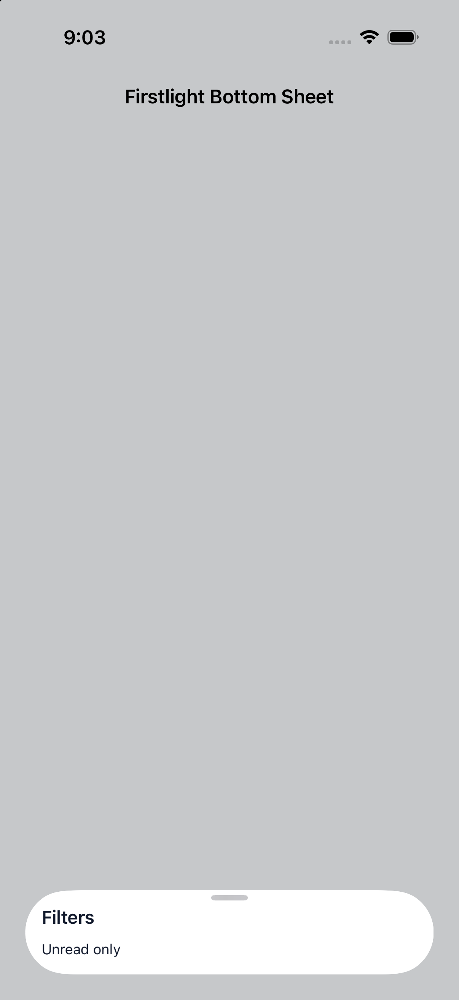
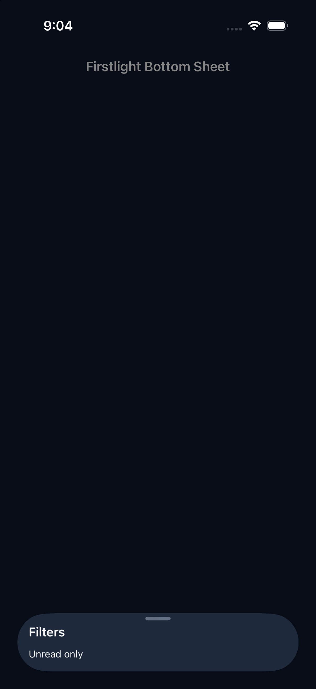
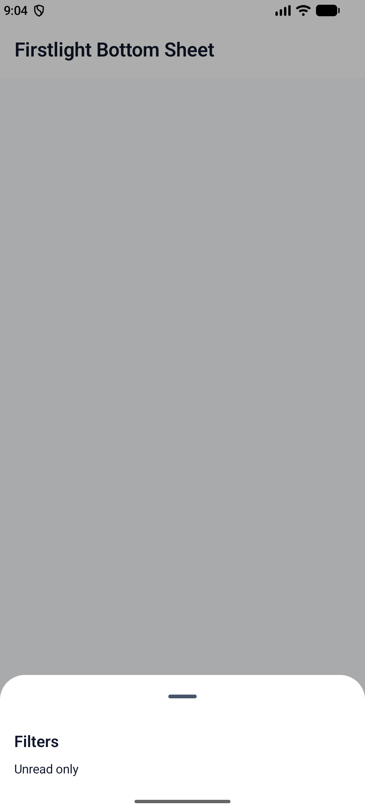
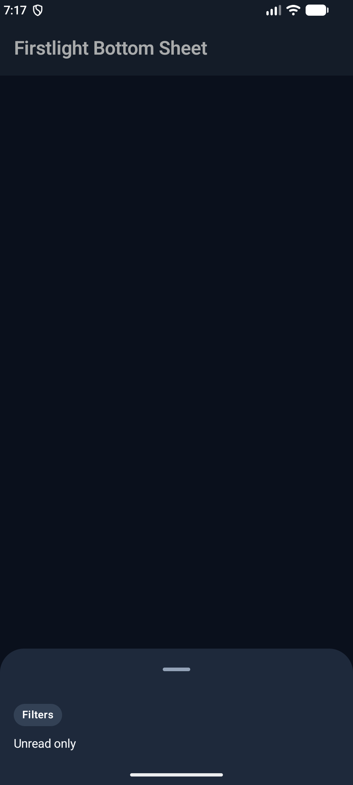

# Bottom Sheet

Bottom Sheet presents authored content in a panel that slides up from the
bottom of the screen. PHP owns whether the sheet is requested; each platform
owns sheet chrome and drag to dismiss. The sheet opens at the height of its
content.

Use [Modal](modal.md) for a full-screen overlay. Use
[Alert Dialog](alert-dialog.md) for a single acknowledgement. Use
[Confirmation Dialog](confirmation-dialog.md) for a confirm/cancel
decision.

## Complete example

```blade
<firstlight:bottom-sheet
    :visible="$showingFilters"
    a11y-label="Filters"
    @dismiss="closeFilters"
>
    <native:text class="text-lg font-semibold text-theme-on-surface">Filters</native:text>
</firstlight:bottom-sheet>
```

The dismiss handler should set `$showingFilters` to `false`.

The visible title is ordinary text styled as a heading. Mobile UI text has no
heading role yet, so screen readers announce the surface by its `a11y-label`.

## Props

| API | Accepted type | Purpose |
| --- | --- | --- |
| `visible` | `bool` | Server-controlled presentation request. Defaults to closed. |
| `a11y-label` | non-empty `string` | Accessible name for the sheet. |
| `a11y-hint` | non-empty `string` | Supplementary screen-reader guidance. |
| `class` | `string` | External EDGE layout utilities. |

## Events

`@dismiss` is required. It runs when the user drags the sheet down, taps
outside, or uses system back. Set the bound visibility property to `false` in
that handler.

There is no overlay `@press`, `native:model`, `dismissible`, or `detents`
API. You don't set the height: the sheet measures its content.

## Height

The sheet opens at the height of its content on both platforms. A short sheet
stays short, and a sheet taller than half the screen opens fully, so a button
at the bottom is visible without dragging. The height follows the content when
it changes, including for larger text sizes, up to a full-height sheet.
Content taller than that scrolls on iOS but is clipped on Android, so keep
sheet content shorter than the screen.

## Platform expression

iOS uses a SwiftUI `.sheet` with a drag indicator and a height detent
measured from the content. Android uses Material 3 `ModalBottomSheet` sized to
its content without the half-height stop. Theme tokens own surface and scrim
colour.

## Screenshots

| Platform | Light | Dark |
| --- | --- | --- |
| iOS |  |  |
| Android |  |  |
