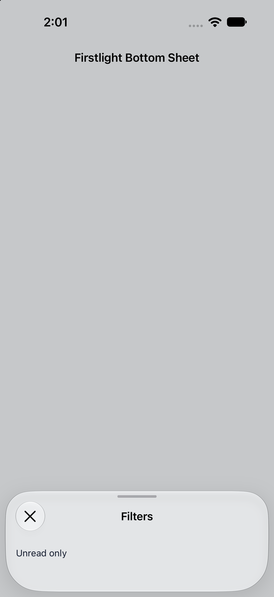
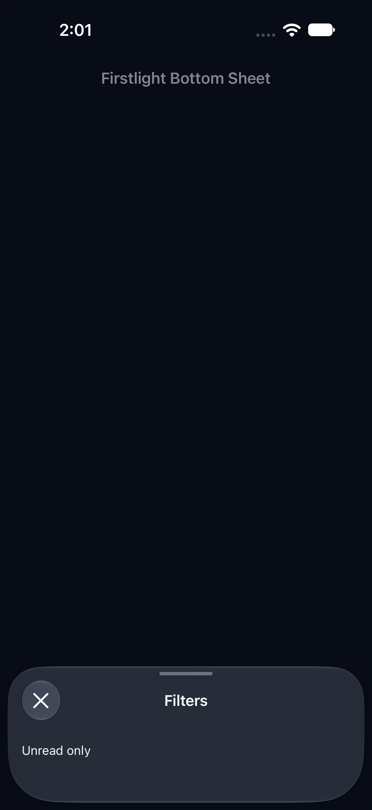
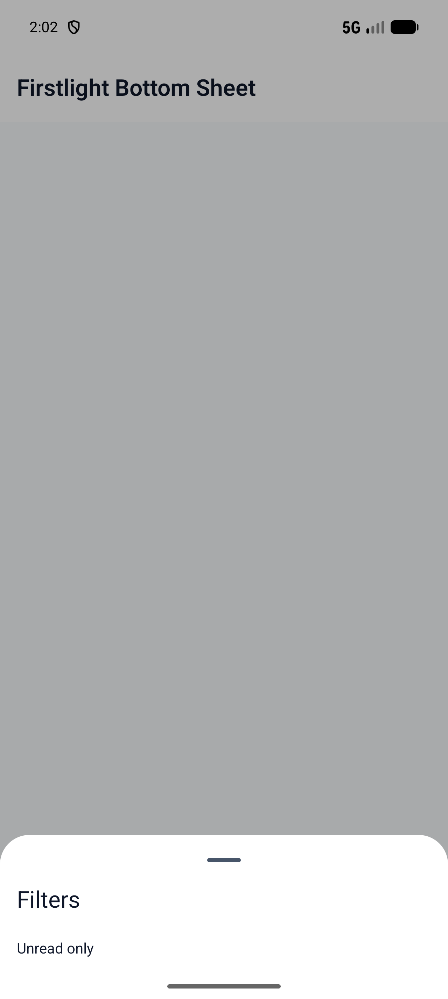
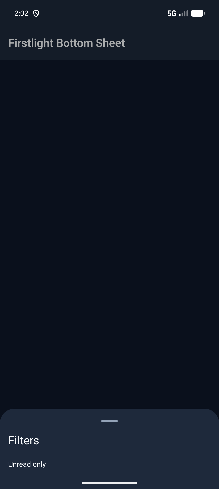

# Bottom Sheet

Bottom Sheet presents authored content in a panel that slides up from the
bottom of the screen. PHP owns whether the sheet is requested; each platform
owns sheet chrome and drag to dismiss. The sheet opens at the height of its
content.

Use [Modal](modal.md) for a full-screen overlay. Use
[Alert Dialog](alert-dialog.md) for a single acknowledgement. Use
[Confirmation Dialog](confirmation-dialog.md) for a confirm/cancel
decision.

## Complete example

```blade
<firstlight:bottom-sheet
    :visible="$showingFilters"
    title="Filters"
    a11y-label="Filters"
    @dismiss="closeFilters"
>
    <native:column class="w-full p-4 gap-3">
        <firstlight:switch label="Unread only" native:model="unreadOnly" />
    </native:column>
</firstlight:bottom-sheet>
```

The dismiss handler should set `$showingFilters` to `false`.

## Title

`title` gives the sheet the heading each platform draws for its own sheets,
so don't author a title row of your own:

- **iOS** puts the content under an inline navigation bar with the title in
  the middle and the system close button on the leading edge, as Apple's
  sheets do. With Liquid Glass the close button is the system's glass
  button; before iOS 26 it is the filled circle sheets used then. Tapping it
  runs `@dismiss`, like a swipe down.
- **Android** shows the title as Material 3 `titleLarge` heading text under
  the drag handle. Material's modal bottom sheet has no close button: it
  closes on a swipe down, a tap outside or back.

Screen readers announce the title as a heading on both platforms. VoiceOver
reads the close button as Firstlight's translated "Close"; set `close-label`
to use your own wording. A sheet without `title` has no bar or heading.

## Props

| API | Accepted type | Purpose |
| --- | --- | --- |
| `visible` | `bool` | Server-controlled presentation request. Defaults to closed. |
| `title` | non-empty `string` | The sheet's heading: an inline navigation bar with a close button on iOS, heading text under the drag handle on Android. Defaults to untitled. |
| `close-label` | non-empty `string` | What VoiceOver reads for the iOS close button. Defaults to Firstlight's translated "Close"; needs `title`. |
| `pinned-footer` | `bool` | Keeps the final direct child outside the scrolling body. Defaults to `false`; requires at least two direct children. |
| `a11y-label` | non-empty `string` | Accessible name for the sheet. |
| `a11y-hint` | non-empty `string` | Supplementary screen-reader guidance. |
| `class` | `string` | External EDGE layout utilities. |

## Events

`@dismiss` is required. It runs when the user drags the sheet down, taps
outside, uses system back, or taps a titled sheet's close button on iOS. Set the bound visibility property to `false` in
that handler.

When a Firstlight screen navigates away, its farewell response closes the sheet
without changing that visibility property. This also covers sheets in nested
children.

There is no overlay `@press`, `native:model`, `dismissible`, or `detents`
API. You don't set the height: the sheet measures its content.

## Height

The sheet opens at the height of its content on both platforms. A short sheet
stays short, and a sheet taller than half the screen opens fully, so a button
at the bottom is visible without dragging. The height follows the content when
it changes, including for larger text sizes, up to a full-height sheet.
Content taller than that scrolls on both platforms.

## Pinned footer

With `pinned-footer`, the final **direct child** is the footer; every earlier
child is scrolling content. Group multiple footer controls in an existing
Mobile UI column. Do not wrap the body and footer in a single outer child.

```blade
<firstlight:bottom-sheet
    :visible="$showingBill"
    pinned-footer
    a11y-label="Review bill"
    @dismiss="closeBill"
>
    <native:column class="w-full p-4 gap-3">
        @foreach ($items as $item)
            <native:text class="text-theme-on-surface">{{ $item['label'] }}</native:text>
        @endforeach
    </native:column>
    <native:column class="w-full p-4 gap-3">
        <native:text class="text-theme-on-surface">Total: {{ $formattedTotal }}</native:text>
        <firstlight:button label="Save" @press="saveBill" />
    </native:column>
</firstlight:bottom-sheet>
```

The app supplies the items, formatted total and handlers. The footer needs no
background: on iOS 26 and later the system blurs body content that scrolls
under it, as under Apple's toolbars, and earlier iOS and Android give it the
sheet's surface. Keep the footer compact; body content must have space to
scroll. PHP owns Save and whether
the sheet closes. Native dismissal and its callback remain unchanged.

## Platform expression

iOS uses a SwiftUI `.sheet` with a drag indicator and a height detent
measured from the content. Android uses Material 3 `ModalBottomSheet` sized to
its content without the half-height stop. Both keep a band for the drag
indicator above your content, so a sheet's top padding starts below the
indicator, as its side padding starts at the sheet edge. On iOS 26 and later
the sheet is the system's Liquid Glass, which turns opaque at full height, and
Buttons and Icon Buttons in its footer take glass. Before iOS 26 and on Android,
theme tokens own surface and scrim colour.

iOS places the footer in a bottom safe-area inset. Android keeps it below the
bounded scrolling body. Both retain their native sheet chrome and insets.
On Android, an authored vertical scroll view or list keeps ownership of body
scrolling, including when nested in a layout column. The sheet supplies the
scrolling viewport only when the body has no vertical scrolling container.

## Screenshots

| Platform | Light | Dark |
| --- | --- | --- |
| iOS |  |  |
| Android |  |  |
