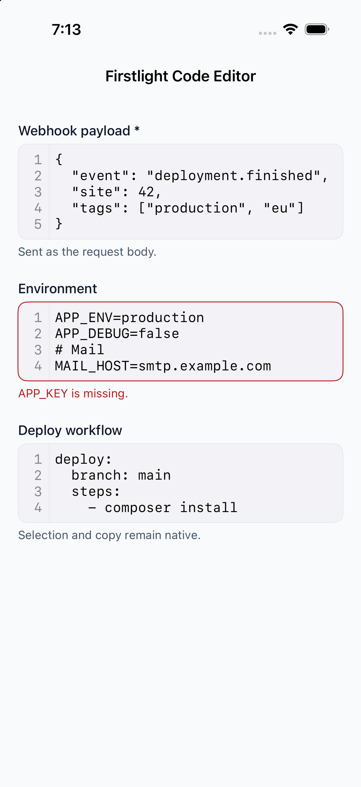
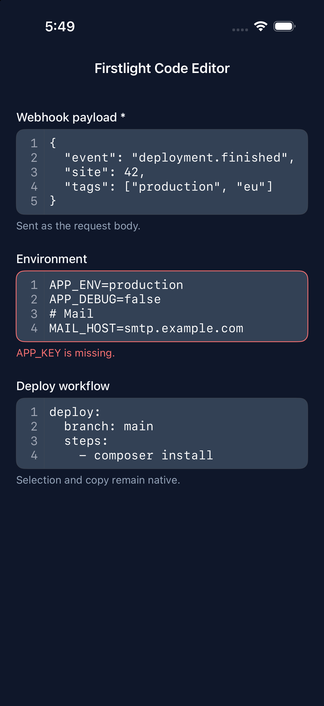
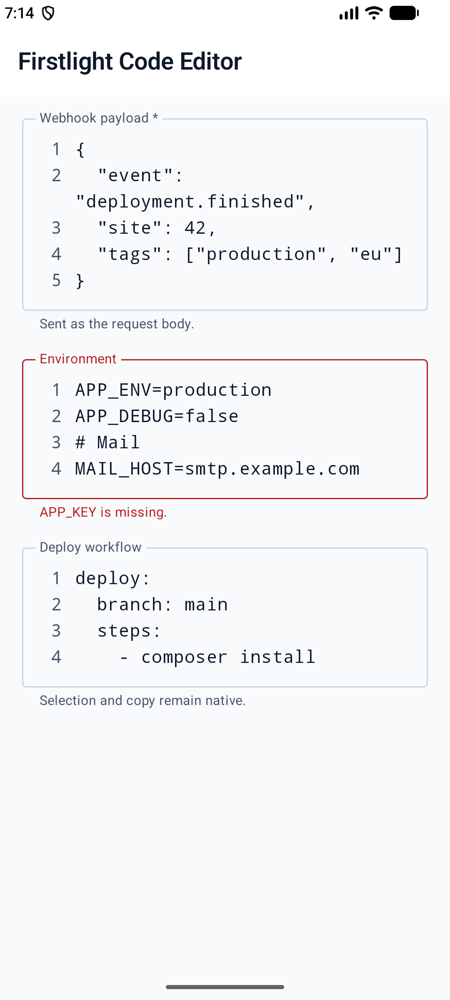
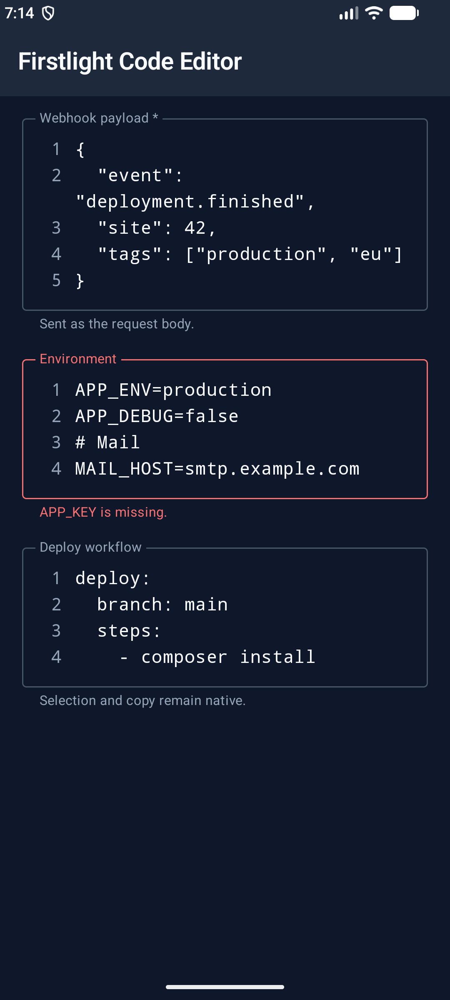

# Code Editor

Code Editor edits plain-text configuration and code — JSON, YAML, `.env`
files, and plain text — in a monospaced native text view with line numbers,
language-aware indentation, and a key row above the software keyboard. It has
no syntax highlighting.

## Complete example

```blade
<firstlight:code-editor
    label="Environment"
    language="env"
    helper="One KEY=value per line."
    native:model.debounce.500ms="environment"
/>
```

A read-only live log that stays at the newest line:

```blade
<firstlight:code-editor
    label="Deployment log"
    :read-only="true"
    :follow="true"
    :wrap="false"
    :max-lines="24"
    :value="$log"
/>
```

## Props

| API | Accepted type | Purpose |
| --- | --- | --- |
| `value` / `native:model` | `string` | Published PHP value, sent verbatim; omission defaults to `''`. |
| `language` | enum string | `plain`, `json`, `yaml`, or `env`; defaults to `plain`. Selects indentation rules and key-row symbols. It never validates or reformats content. |
| `label` | `string` | Visible label and accessibility-name fallback. |
| `helper` | `string` | Supporting guidance below the field. |
| `error` | `string` | Validation feedback that replaces helper text. |
| `required` | `bool` | Communicates required metadata without performing validation. |
| `disabled` | `bool` | Prevents focus and editing. |
| `read-only` | `bool` | Keeps native selection, copy, and scrolling while preventing edits; hides the key row. |
| `line-numbers` | `bool` | Shows the line-number gutter; defaults to `true`. |
| `wrap` | `bool` | Wraps long lines; defaults to `true`. `false` scrolls horizontally. |
| `indent` | `int` | `2` or `4` spaces per level; defaults to `2`. |
| `follow` | `bool` | Keeps the view pinned to the end across programmatic updates; defaults to `false`. Requires `read-only`. |
| `min-lines` | positive `int` | Minimum visible lines; defaults to `6`. |
| `max-lines` | positive `int` | Maximum visible lines before native scrolling; defaults to `20`. |
| `a11y-label` | `string` | Explicit accessible name when no visible label is appropriate. |
| `a11y-hint` | `string` | Additional VoiceOver or TalkBack guidance. |
| `class` | `string` | External EDGE layout for the complete field. |

`max-lines` must be greater than or equal to `min-lines`. Public Blade examples
use kebab-case. The PHP element also accepts `lineNumbers`, `readOnly`,
`minLines`, and `maxLines` aliases.

Code Editor always turns off autocorrect, autocapitalization, and spell
checking, and uses the system monospaced font at the platform's text size.
`placeholder`, `autocorrect`, `autocapitalize`, `keyboard`, `content-type`,
icons, `secure`, `@submit`, and styling attributes are rejected.

## Editing

Return keeps the current line's leading spaces or tabs. In `json`, Return after
an opening `{` or `[` adds one level, and Return between a bracket pair splits
it onto three lines. Typing `}` or `]` at the start of a line removes one
level. In `yaml`, Return after a line ending in `:` adds one level; comments
are ignored. `env` and `plain` only keep the current indentation.

Indent and Outdent act on the current line or every selected line. Toggle
comment, in `yaml` and `env`, adds or removes `# ` on the current or selected
lines. Indentation always inserts spaces; existing tabs are kept.

### Key row

While the field is focused and editable, a key row sits above the software
keyboard. It is hidden when a hardware keyboard is attached, where Tab and
Shift-Tab indent and outdent.

| Language | Keys after Indent, Outdent, Undo, Redo |
| --- | --- |
| `json` | `{` `}` `[` `]` `"` `:` `,` |
| `yaml` | `:` `-` `#` `"` `'` `\|`, Toggle comment |
| `env` | `=` `#` `"` `$` `{` `}` `_`, Toggle comment |
| `plain` | `(` `)` `[` `]` `{` `}` `"` `'` |

Each key press is one undoable edit. Key names and accessible names are
package chrome; see [Localize Firstlight chrome](../how-to/localize.md).

## Events and synchronisation

`@change` receives the complete current string. Plain `native:model` and
`.live` publish while editing. `.blur` and `.lazy` publish on focus loss.
`.debounce.500ms` publishes after the quiet period and flushes on blur.
Durations below 50 milliseconds are rejected.

While the field is focused, the native buffer, cursor, selection, IME
composition, scroll position, and undo history stay local. PHP
acknowledgements do not replace them. Unfocused programmatic updates replace
the text, clear undo history, and never emit `@change`.

### Scroll position and `follow`

A programmatic update never jumps to the top. The first visible line stays in
place when lines are appended or removed from the start, and otherwise the
previous scroll offset is kept.

With `follow`, the view starts at the end and stays there across updates while
it is within one line of the end, including when PHP trims the start of the
content. Scrolling up stops following; scrolling back to the end resumes it.
While a person holds a selection in a read-only editor, updates wait until the
selection collapses so copying is never interrupted. Updates are not announced
to VoiceOver or TalkBack.

## Validation and accessibility

Contract exceptions reject invalid types, unknown languages, indents other
than `2` or `4`, unordered line bounds, `follow` without `read-only`, and
unsupported sync modes before publication. Screens that `use ValidatesFields`
auto-bind the first MessageBag message for the field's `native:model` or
`error-for` name; an authored `error` wins. See
[Validate fields](../how-to/validate-fields.md).

A visible `label` or explicit `a11y-label` is required during development.
Line numbers are hidden from assistive technology, so validation messages
should quote the offending key or content rather than only a line number.
Every key-row key has an accessible name and meets the 44 pt / 48 dp target.
Code text stays left-to-right in right-to-left layouts.

## Security

`.env` content often contains secrets. Code Editor is not a secure field: it
does not mask values, block screenshots, or guarantee that keyboards skip
learning what is typed. Decide whether editing secrets on the device is
acceptable for your application.

## Platform behaviour

iOS uses a TextKit 2 `UITextView` in Apple-native field composition, with a
line-number gutter, an input-accessory key row with a Done button, and the
text view's own undo manager. Android uses Compose `BasicTextField` on
`TextFieldState` inside Material 3 outlined decoration, with a line-number
gutter, a Material key row above the keyboard, and the text field's undo
history. Both platforms run the same indentation and scroll-anchor rules,
checked against shared test fixtures.

## Screenshots

| Platform | Light | Dark |
| --- | --- | --- |
| iOS |  |  |
| Android |  |  |
