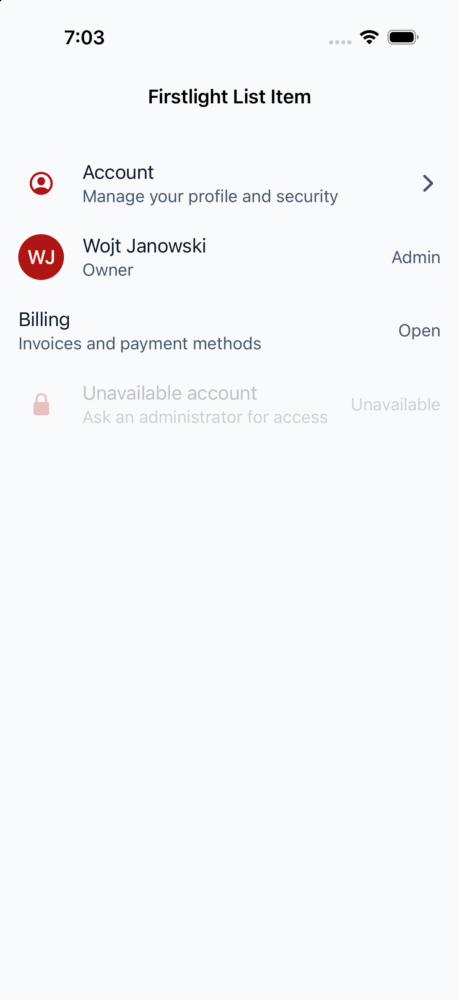
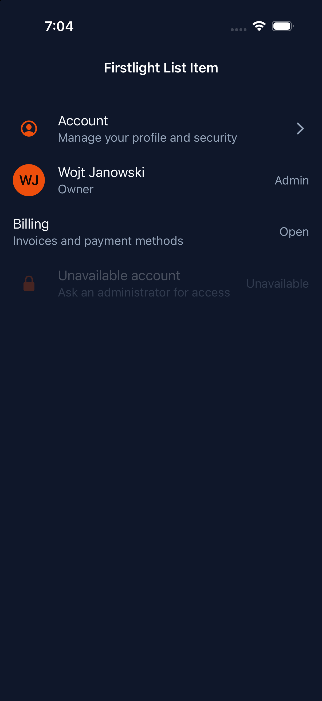
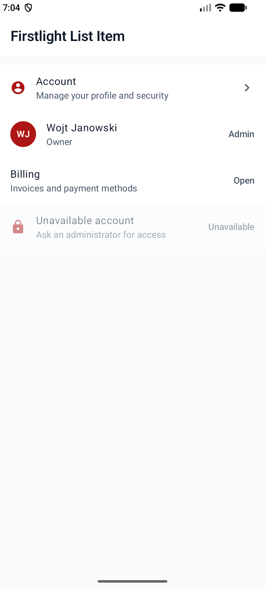
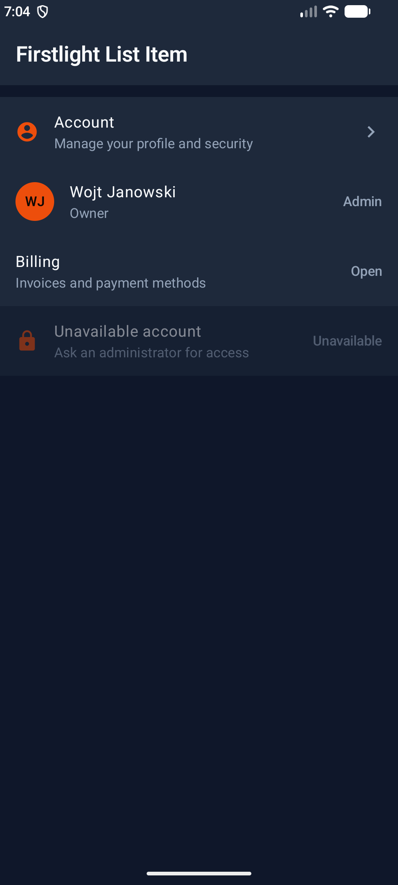

# List Item

List Item presents one tappable application row with a primary headline,
optional supporting text, an optional leading identity, and an optional
trailing affordance. It renders as a genuine SwiftUI button row on iOS and a
Material 3 List Item on Android.

## Complete example

```blade
<firstlight:list-item
    headline="Account"
    supporting="Manage your profile and security"
    leading-icon="person"
    leading-icon-ios="person.crop.circle"
    leading-icon-android="account_circle"
    trailing-icon="chevron-right"
    trailing-icon-ios="chevron.right"
    trailing-icon-android="chevron_right"
    a11y-hint="Opens account settings"
    :disabled="! $canManageAccount"
    @press="openAccount"
/>
```

List Item is self-closing. Its content is semantic rather than a general child
slot: arbitrary text, controls, and layouts cannot be nested inside the row.

## Props

| API | Accepted type | Purpose |
| --- | --- | --- |
| `headline` | non-empty `string` | Required primary text and default accessible name. |
| `supporting` | non-empty `string` | Optional secondary text below the headline. |
| `leading-icon` | non-empty `string` | Optional shared leading icon and cross-platform fallback. |
| `leading-icon-ios` | `IosSymbol|string` | Optional iOS override; requires `leading-icon`. |
| `leading-icon-android` | `AndroidSymbol|string` | Optional Android override; requires `leading-icon`; typed variants are preserved on the wire. |
| `leading-avatar` | non-empty `string` | Optional image source representing the row subject. |
| `leading-monogram` | one or two characters | Optional short identity marker such as `WJ`. |
| `trailing-icon` | non-empty `string` | Optional shared decorative affordance icon. |
| `trailing-icon-ios` | `IosSymbol|string` | Optional iOS override; requires `trailing-icon`. |
| `trailing-icon-android` | `AndroidSymbol|string` | Optional Android override; requires `trailing-icon`; typed variants are preserved on the wire. |
| `trailing-text` | non-empty `string` | Optional short metadata or affordance text. |
| `leading-actions` | `array` of action descriptors | Optional actions revealed from the logical leading edge inside List. |
| `trailing-actions` | `array` of action descriptors | Optional actions revealed from the logical trailing edge inside List. |
| `disabled` | `bool` | Prevents row and swipe action presses and exposes native disabled state. Defaults to `false`. |
| `a11y-label` | non-empty `string` | Optional replacement for the combined visible accessible name. |
| `a11y-hint` | non-empty `string` | Optional supplementary VoiceOver or TalkBack guidance. |
| `class` | `string` | External EDGE layout utilities. |

Choose at most one leading source: icon, avatar, or monogram. Choose at most
one trailing affordance: icon or text. Supporting text and both edges may be
omitted for a headline-only row.

Blade examples use kebab-case names. The equivalent `leadingIcon`,
`leadingIconIos`, `leadingIconAndroid`, `leadingAvatar`, `leadingMonogram`,
`trailingIcon`, `trailingIconIos`, `trailingIconAndroid`, and `trailingText`
aliases are also accepted for parity with NativePHP authoring.

## Swipe actions

Put swipe-enabled rows inside `firstlight:list`, directly or in a
`firstlight:list-section`. The same example works on both platforms:

```blade
<firstlight:list>
    <firstlight:list-item
        headline="Message"
        @press="openMessage(42)"
        :leading-actions="[
            ['method' => 'archive(42)', 'label' => 'Archive', 'icon' => 'archive'],
        ]"
        :trailing-actions="[
            ['method' => 'requestDestroy(42)', 'label' => 'Delete', 'role' => 'destructive'],
            ['method' => 'flag(42)', 'label' => 'Flag'],
        ]"
    />
</firstlight:list>
```

Each descriptor requires a non-empty `method` callback expression and visible
`label`. Optional fields are `icon` (shared fallback), `ios` (`IosSymbol|string`),
`android` (`AndroidSymbol|string`), and `role` (empty or `destructive`). Icon
overrides require a shared `icon`. Labels also name the accessibility actions.
Empty arrays mean no actions on that edge. `leadingActions` / `trailingActions`
attribute aliases and fluent `->leadingActions([...])` / `->trailingActions([...])`
are supported.

The first action is nearest its originating edge. Leading and trailing follow
the reading direction, including RTL. Swipe to reveal, then tap a button:
**full swipes never execute actions**. The ordinary `@press` remains independent.
On Android, tapping an exposed foreground row closes its drawer; tap the closed
row to invoke `@press`.

Swiping never removes a row. Even `role="destructive"` only selects semantic
destructive styling; PHP decides whether to confirm, authorize, and delete.
Connect a Delete action to the [destructive-list helper](../how-to/destroy-list-items.md)
using a stable domain key rather than a list position. Publishing updated
actions or disabling the row replaces native action availability without
emitting an event. Android also closes the drawer when row configuration changes.

Action colours come from the native theme's primary/destructive token pairs.
Per-action tint, enabled flags, full-swipe options, and the legacy
`on-swipe-delete` shortcut are not supported. Omit unavailable actions or disable
the entire row, and always authorize sensitive operations in PHP.

## Events and state timing

`@press` is required and invokes the named PHP action once after a native user
press:

```php
public function openAccount(): void
{
    // Perform the action and publish any resulting screen state.
}
```

List Item has no `value`, `native:model`, selected state, or `@change`. The
native row owns transient press feedback and swipe reveal state. PHP owns the
action outcome and publishes any subsequent headline, supporting text,
affordance, accessibility, or disabled state. Programmatic publications never
emit a press.

## Disabled behaviour

A disabled row retains its visible content, uses native disabled appearance,
exposes disabled accessibility semantics, and emits neither `@press` nor swipe
action callbacks. New swipes and screen-reader actions are unavailable. On iOS,
an already-open system drawer can remain visible until dismissed, but tapping
its retained buttons emits no callback. Android closes the drawer immediately.
The `disabled` value must be a real boolean; strings and integers are rejected.

## Leading identity and icons

Use `leading-avatar` when an image identifies the row subject, or
`leading-monogram` for a one- or two-character textual identity. Use
`leading-icon` for a semantic category or destination glyph. All leading
content is decorative inside the row's single accessibility node because the
headline carries the subject's accessible meaning.

Icon resolution happens in PHP. The shared icon is the deterministic fallback;
the iOS or Android override wins on its platform. A typed Android symbol keeps
its filled or outlined variant in the native wire metadata. Overrides without
their shared fallback are invalid.

## Trailing affordances

Use `trailing-icon` for a decorative directional or state affordance, or
`trailing-text` for short metadata such as `Admin`. The trailing content is not
a second action. It remains silent to assistive technology inside the row's
single button node.

Independent trailing buttons, switches, checkboxes, radio buttons, menus, and
other embedded targets are excluded. Swipe actions are separate from these
decorative trailing affordances.

## Accessibility

By default, assistive technology combines the headline and supporting text as
the row's accessible name. `a11y-label` replaces that name and `a11y-hint` adds
context. The complete row is one button node with disabled state and a minimum
interaction target of 44 points on iOS or 48 dp on Android.

Leading avatars, monograms, icons, and trailing content are decorative and do
not add duplicate VoiceOver or TalkBack stops. Dynamic Type, Android font
scaling, right-to-left layout, native contrast, focus, and press feedback remain
platform-owned.

Inside List, swipe actions are available through native VoiceOver actions and
TalkBack custom actions without performing a swipe gesture. Revealed Android
buttons also expose their visible labels and button roles.

## Validation and excluded APIs

Firstlight rejects missing or blank headlines, missing `@press`, blank optional
text, non-boolean disabled values, invalid icon override types, icon overrides
without shared fallbacks, ambiguous leading or trailing content, and content
slots. It also rejects overline text, embedded controls, independent trailing
actions, malformed or unlabelled swipe descriptors, long-press gestures, menus,
navigation directives, model or selection state, loading and validation props,
colours, elevation, typography, and per-platform layout escape hatches.

## Platform behaviour

iOS uses a SwiftUI `Button` composition with Apple-native headline and
supporting typography, optional circular identity or SF Symbol, optional
trailing metadata or symbol, native press and disabled behaviour, and a
44-point minimum target.

Android uses Material 3 `ListItem` inside one enabled-aware clickable surface,
with Material typography, content slots, ripple and disabled semantics, and a
48-dp minimum target. Shared content and action meaning stay the same while
spacing, typography, motion, and pressed state remain native.

## Compatibility

List Item supports the versions listed in the current [compatibility
reference](../reference/compatibility.md). The host application must compile
both Firstlight-owned native renderers declared by the package manifest.

## Screenshots

| Platform | Light | Dark |
| --- | --- | --- |
| iOS |  |  |
| Android |  |  |
