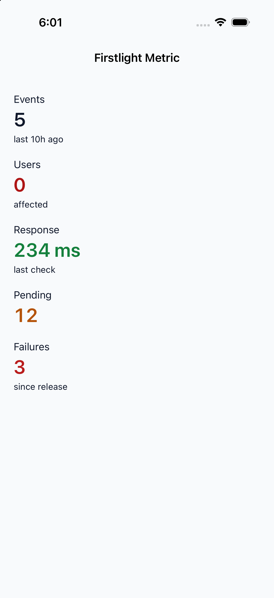
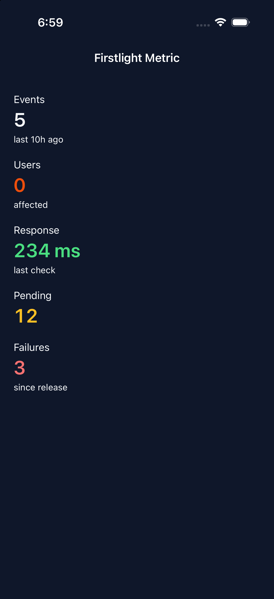
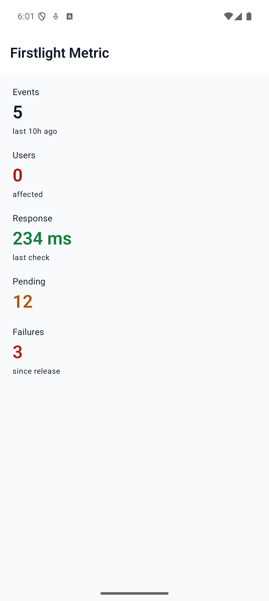
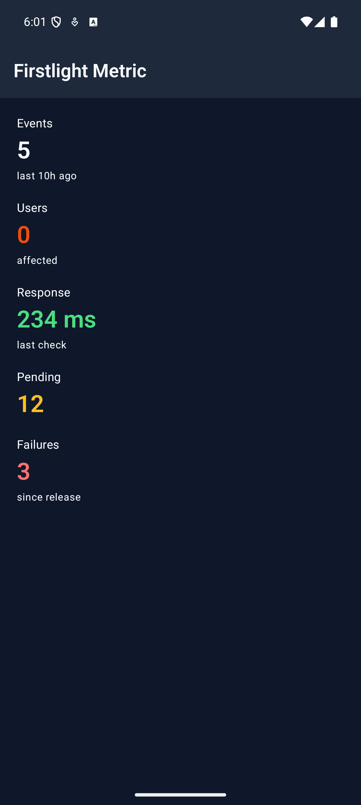
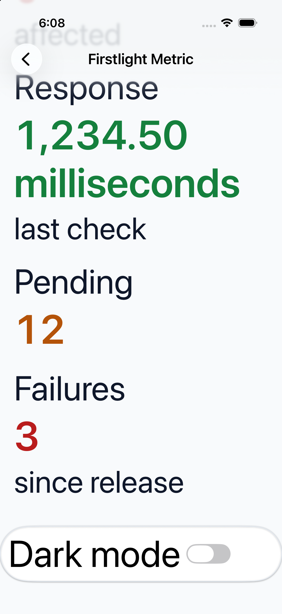
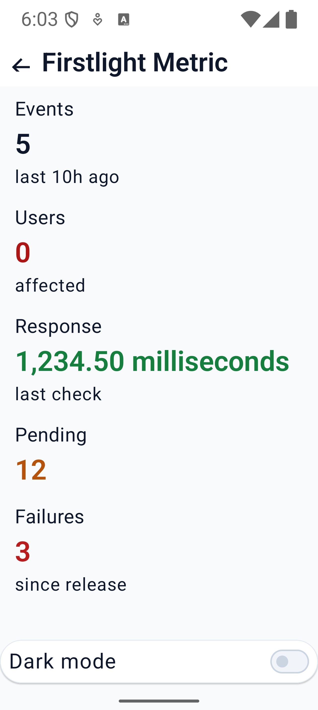

# Metric

Metric displays a named statistic, such as an event count or response time. Its
label, value and optional detail form one screen-reader element, not three text
fragments. It does not draw a tile, panel or grid; use Mobile UI for outer layout.

```blade
<native:column class="w-full gap-4">
    <firstlight:metric label="Events" value="5" detail="last 10h ago" />
    <firstlight:metric label="Users" value="0" detail="affected" />
    <firstlight:metric label="Response" value="234 ms" detail="last check" tone="success" />
</native:column>
```

## Props

| Prop | Contract |
| --- | --- |
| `label` | Required nonempty string naming the measurement. |
| `value` | Required nonempty **string**, already formatted in PHP. `"0"` is valid. |
| `detail` | Optional string; omitted or empty means no supporting line. |
| `tone` | `neutral` (default), `info`, `success`, `warning`, or `danger`; colours the value using semantic theme tokens. |
| `a11y-label` | Optional nonempty name replacing the default `label: value, detail`. Use it for localized full sentences or pronunciation. |
| `a11y-hint` | Optional nonempty supplementary description. |
| `class` | External EDGE layout only. Do not impose a fixed height that clips large text. |

CamelCase `a11yLabel` and `a11yHint` aliases are accepted. Format units, dates,
numbers and relative times in the application; Metric does not parse them or run a
timer. For bound numeric counts, format explicitly, for example `:value="(string) $events"`.

Programmatic roots can use `Metric::make('Events', '5')` from
`FirstlightUI\Elements\Metric`. `applyAttributes()` accepts the same props.

## Events, values and state

Metric is static: there is no `native:model`, `@change`, `@press`, selected,
disabled, loading or error state. New PHP publications update the text without
emitting an event. It accepts no children. Put a labelled Button alongside a
metric when an action is needed; it does not make a generic container accessible.

## Accessibility and platforms

SwiftUI uses native text styles and monospaced digits. Compose uses Material text
styles and tabular figures (`tnum`). Values wrap at large Dynamic Type/font scales;
they are not shrunk or ellipsized. Available width and font glyph support determine
line wrapping. The component is a single static accessibility element, with no
button role or duplicate child announcements. Android appends the hint to its
content description; iOS supplies a separate accessibility hint.

All five tones inherit the application's theme, including package warning tokens.
Tone is supplementary; always communicate the measurement in text as well.

## Validation and compatibility

Missing/blank labels or values, non-string content, unsupported tones, empty
explicit accessibility text and interaction/field-state attributes throw
`InvalidArgumentException`. Metric uses the ordinary Firstlight installation and
the [supported NativePHP versions](../reference/compatibility.md).

## Screenshot evidence

The stable showcase route is `/captures/metric`. These native captures use
iPhone 17 Pro / iOS 26.5 and an Android 17 (API 37) emulator.

| Platform | Light | Dark |
| --- | --- | --- |
| iOS |  |  |
| Android |  |  |

The interactive showcase's longer value remains complete at maximum iOS
accessibility text size and Android font scale 2.0. The iOS capture is scrolled to
show the wrapped value; content behind native navigation chrome is outside the
current viewport, not truncated by Metric.

| iOS maximum accessibility text | Android font scale 2.0 |
| --- | --- |
|  |  |

These are simulator/emulator visual checks. Spoken VoiceOver/TalkBack traversal
and physical-device release qualification remain unverified.
