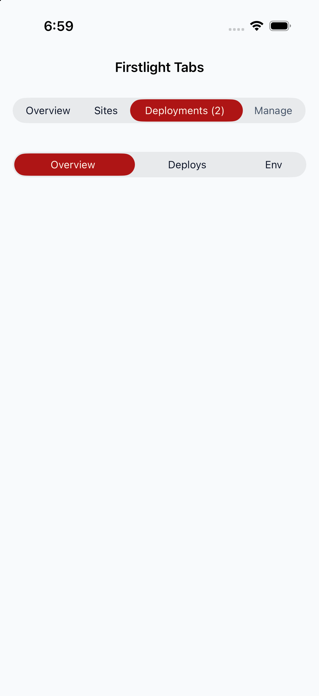
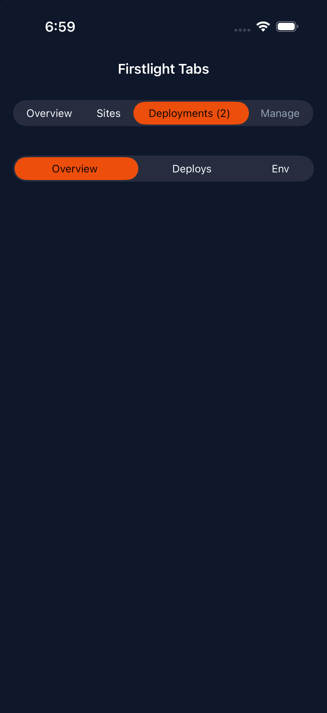
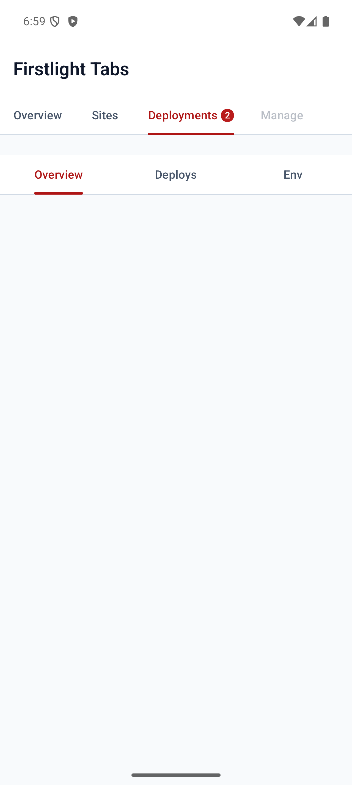
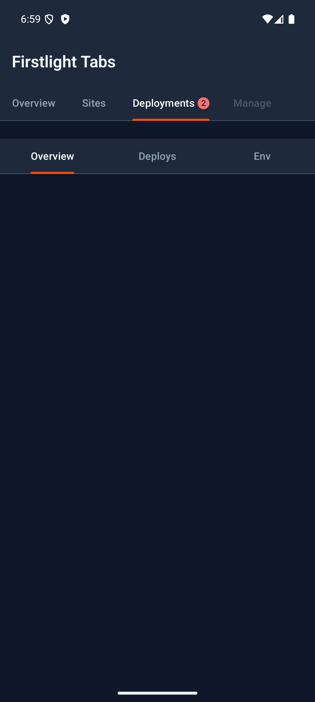

# Tabs

Tabs switches between sections of the same object within one screen, such as a server's Overview, Sites, Deployments, and Manage. Tabs draws only the selector; your component renders the active section, so inactive sections do no work until someone selects them.

Use [Segmented](segmented.md) to choose a value or filter for the content already on screen. Use Tabs to choose which content is on screen.

## Complete example

```php
public string $tab = 'overview';

public int $failedDeployments = 2;

public function render(): View
{
    return view('native.server', [
        'sections' => [
            ['value' => 'overview', 'label' => 'Overview'],
            ['value' => 'sites', 'label' => 'Sites'],
            [
                'value' => 'deploys',
                'label' => 'Deployments',
                'badge' => $this->failedDeployments,
                'badge-a11y-label' => "{$this->failedDeployments} failed",
            ],
            ['value' => 'manage', 'label' => 'Manage'],
        ],
    ]);
}
```

```blade
<firstlight:tabs native:model="tab" :tabs="$sections" label="Server sections" />

@if ($tab === 'overview')
    {{-- Overview rows --}}
@elseif ($tab === 'sites')
    {{-- Sites list --}}
@elseif ($tab === 'deploys')
    {{-- Deployments list --}}
@else
    {{-- Manage rows --}}
@endif
```

A value-to-label map is enough when no tab needs a badge or availability:

```blade
<firstlight:tabs
    native:model="tab"
    :tabs="['overview' => 'Overview', 'sites' => 'Sites', 'deploys' => 'Deployments', 'manage' => 'Manage']"
    label="Server sections"
/>
```

## Props

| API | Accepted type | Purpose |
| --- | --- | --- |
| `tabs` | `array` | A value-to-label map, or a list of rich tabs. |
| `value` / `native:model` | `string` or `null` | Stable value of the visible section. `null` selects no tab. |
| `label` | `string` | Accessible name of the tab group. Tabs draws no visible group label. |
| `disabled` | `bool` | Disables every tab. |
| `a11y-label` | `string` | Overrides `label` as the group's accessible name. |
| `a11y-hint` | `string` | Additional VoiceOver and TalkBack guidance for the group. |
| `class` | `string` | External EDGE layout utilities. |

Rich tabs accept these fields:

| Field | Accepted type | Purpose |
| --- | --- | --- |
| `value` | non-empty `string` | Stable tab value. Required. |
| `label` | non-blank `string` | Visible tab label. Required. |
| `badge` | non-negative `int` or `null` | Count shown on the tab. `0` and `null` hide it; counts above 99 show `99+`. |
| `badge-a11y-label` / `badgeA11yLabel` | `string` | Spoken badge text, such as `2 failed`. Defaults to the displayed count. |
| `disabled` | `bool` | Makes one tab unavailable. |

## Events

`@change` receives the selected tab's stable value. `native:model` normally generates this callback. Tapping the selected tab or a disabled tab emits nothing.

## State timing

Tabs is [server-authoritative](../concepts/server-authoritative-state.md). A tap emits immediately, but the selection moves only when PHP publishes the new value. To reject a change, bind `:value` and decide in your handler:

```blade
<firstlight:tabs :value="$tab" @change="selectTab" :tabs="$sections" label="Server sections" />
```

```php
public function selectTab(string $tab): void
{
    if ($tab === 'manage' && ! $this->canManage) {
        return; // Overview stays selected.
    }

    $this->tab = $tab;
}
```

Changing `$tab` from PHP, including in `mount()`, selects that tab without emitting `@change`. Use plain `native:model` or `native:model.live`; deferred `blur` and `debounce` modes are rejected.

## Open a specific tab

NativePHP hydrates public properties from matching route parameters, so an optional route segment can open a tab directly, for example from a notification:

```php
Route::native('/servers/{server}/{tab?}', ServerScreen::class);
```

```php
public string $tab = 'overview';

public function mount(): void
{
    if (! in_array($this->tab, ['overview', 'sites', 'deploys', 'manage'], true)) {
        $this->tab = 'overview';
    }
}
```

The NativePHP router passes route parameters, not query strings, so use `/servers/12/deploys` rather than `/servers/12?tab=deploys`.

## Tabs and values

A tab group has two to five tabs. Keep each hub to five sections and move anything else into rows on a Manage tab. An empty collection renders an inert disabled control, so a permission-filtered list never fails at runtime; one tab or more than five tabs fail with guidance.

Values are non-empty strings and must be unique. PHP turns numeric-string array keys such as `'1'` into integers, so integer values are rejected: use words such as `'overview'`. A selected value that is not in `tabs` leaves every tab unselected; Tabs never selects the first tab for you.

Per-tab icons are not supported yet. A native iOS segment shows a title or an image but not both, so Firstlight defers icons rather than ship them on one platform.

## Disabled behaviour

`disabled` prevents every tab from emitting. A rich tab's `disabled: true` prevents only that tab from emitting and dims it.

## Accessibility

Provide `label` or `a11y-label`; Firstlight warns during development when both are blank. VoiceOver and TalkBack announce each tab with its label and badge text, its tab role, its selected or disabled state, and its position, such as "Tab 2 of 4". Selection is shown by the native indicator or segment fill, not by colour alone, and every tab meets the platform minimum target of 44 points on iOS and 48 dp on Android.

## Validation and failure behaviour

Tabs fails before publication when `tabs` is not an array, has one or more than five entries, has blank labels, duplicate or non-string values, unknown rich fields, a non-integer or negative `badge`, a non-boolean `disabled`, or icon fields. It also rejects `options`, `helper`, `error`, `required`, `multiple`, `icon`, `variant`, and `scrollable` because they do not belong to tab navigation, and a non-string selected value.

## Platform behaviour

iOS uses a native `UISegmentedControl`. Place Tabs full width directly under the navigation bar: iOS insets the segmented control by the system margin, while the Android tab row spans the width. Segments size to their labels, and a visible count follows the label, such as `Deployments (2)`. VoiceOver receives the group as a tab bar with one selectable tab per segment. Like Segmented, segment titles stop growing at accessibility text sizes and may truncate; VoiceOver still reads each full name.

Android uses Material 3 `PrimaryTabRow` with its moving indicator and a Material 3 `Badge` after the label. When a label does not fit its equal share of the width on one line, including at large font scales, the row switches to Material's `PrimaryScrollableTabRow`, as `TabLayout` does in its automatic mode.

Tabs does not pin itself under the top bar or animate between sections. Swiping between sections is not supported.

## Compatibility

Tabs supports the versions listed in the current [compatibility reference](../reference/compatibility.md) and requires both native renderers to be compiled into the host application.

## Screenshots

| Platform | Light | Dark |
| --- | --- | --- |
| iOS |  |  |
| Android |  |  |
