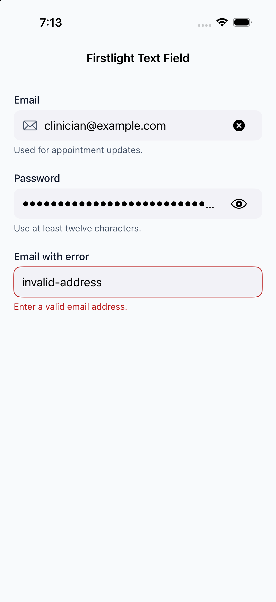
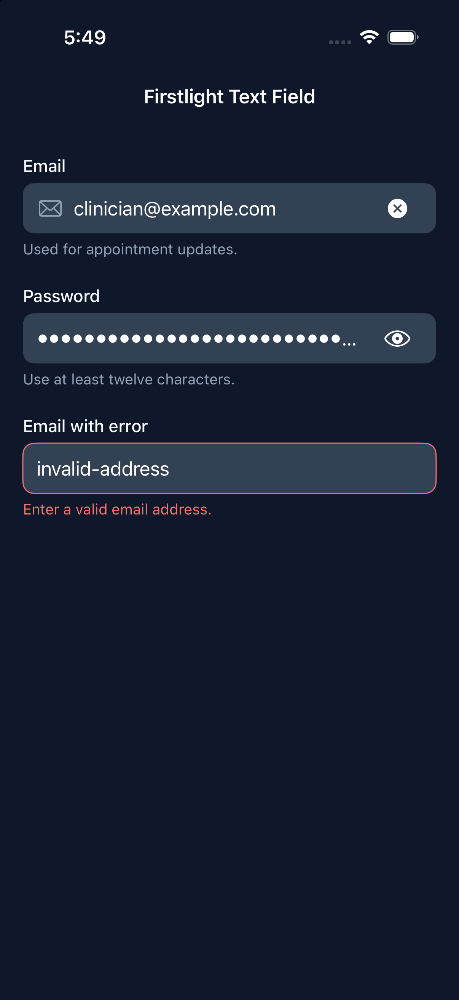
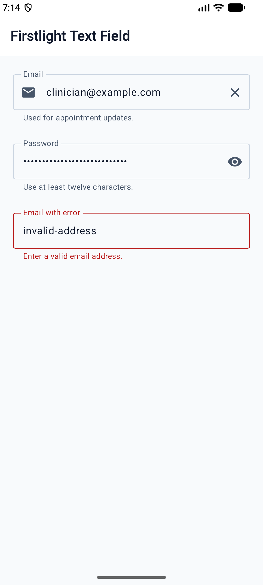
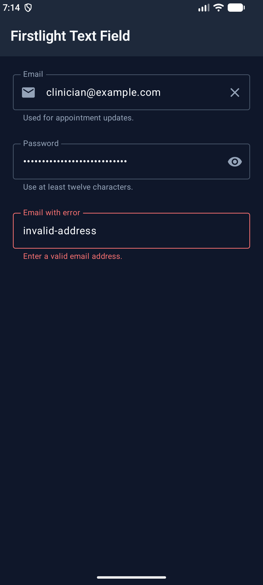

# Text Field

Text Field enters and edits one line of text using the native field, keyboard,
autofill, selection, and accessibility behaviour of each platform.

## Complete example

```blade
<firstlight:text-field
    label="Email"
    placeholder="you@example.com"
    helper="Used for appointment updates."
    keyboard="email"
    content-type="email"
    autocapitalize="none"
    :autocorrect="false"
    clearable
    native:model.blur="email"
/>
```

## Props

| API | Accepted type | Purpose |
| --- | --- | --- |
| `value` / `native:model` | `string` | Published PHP value; omission defaults to `''`. |
| `label` | `string` | Visible label and accessibility-name fallback. |
| `placeholder` | `string` | Short example; never a replacement for a label. |
| `helper` | `string` | Supporting guidance below the field. |
| `helper-tone` | `neutral`, `success`, or `warning` | Meaning of helper text. Defaults to `neutral`; `error` always takes precedence. |
| `error` | `string` | Validation feedback that replaces helper text. |
| `required` | `bool` | Communicates required metadata without performing validation. |
| `disabled` | `bool` | Prevents focus, editing, and every action. |
| `read-only` | `bool` | Allows native selection and copy while preventing edits and changes. |
| `keyboard` | enum string | `text`, `email`, `phone`, `url`, `number`, or `decimal`. |
| `content-type` | enum string | `name`, `username`, `email`, `password`, `new-password`, or `one-time-code`. |
| `secure` | `bool` | Masks display without changing the stored string. |
| `mask` | `string` | Formats the display as the person types: `#` is a digit, `A` a letter, `*` either, and every other character a literal. The bound value keeps only slot characters. See [Input masks](#input-masks). |
| `autocapitalize` | enum string | `none`, `sentences`, `words`, or `characters`; omission keeps platform policy. |
| `autocorrect` | `bool` | Explicitly enables or disables platform autocorrection. |
| `submit-label` | enum string | `done`, `go`, `next`, `search`, or `send`; omission keeps the platform default. |
| `leading-icon` | `string` | Shared decorative leading icon fallback. |
| `leading-icon-ios` | `IosSymbol|string` | iOS leading icon override. |
| `leading-icon-android` | `AndroidSymbol|string` | Android leading icon and variant override. |
| `trailing-icon` | `string` | Shared decorative or authored-action icon fallback. |
| `trailing-icon-ios` | `IosSymbol|string` | iOS trailing icon override. |
| `trailing-icon-android` | `AndroidSymbol|string` | Android trailing icon and variant override. |
| `trailing-a11y-label` | `string` | Required accessible name when `trailing-icon` has `@press`. |
| `clearable` | `bool` | Adds a native clear action while editable text is non-empty. The clear accessibility label is package chrome; see [Localize chrome](../how-to/localize.md). |
| `revealable` | `bool` | Adds native show/hide password state; requires `secure`. Show and hide accessibility labels are package chrome; see [Localize chrome](../how-to/localize.md). |
| `a11y-label` | `string` | Explicit accessible name when no visible label is appropriate. |
| `a11y-hint` | `string` | Additional VoiceOver and TalkBack guidance. |
| `class` | `string` | External EDGE layout for the complete field. |

## Events and synchronisation

Use `helper="Checksum OK" helper-tone="success"`,
`helper="Check this" helper-tone="warning"`, or neutral `helper="From label"`.
The app supplies meaningful text: colour alone does not announce success or
warning. Helpers remain guidance, not validation errors or automatic live
announcements. An `error` replaces the helper and retains native error
semantics regardless of helper tone. Native semantic colours are adjusted to
retain readable contrast against the field surface.

`@change` receives the current string. `@submit` flushes any pending change,
then receives the same current string. An authored interactive trailing icon
uses standard `@press` and receives no text argument.

Plain `native:model` and `.live` publish while editing. `.blur` and `.lazy`
publish on focus loss or submit. `.debounce.500ms` publishes after the quiet
period and flushes on blur or submit; durations below 50 ms are rejected.
Native typing, selection, cursor position, and marked-text composition remain
local while focused so PHP acknowledgements do not cause keyboard jumps.

On iOS and Android, pressing a `<firstlight:button>` or `<firstlight:icon-button>`
while the field is focused queues its pending `.blur` or `.debounce` change
before the press. This orders event posting; it does not wait for PHP to process
the change. List Item presses do not flush the field first. Android uses Mobile's
synchronous focused-input flush hook rather than waiting for blur. A button press is not the
field's `@submit` event; for keyboard submission, the field's own `@submit`
handler receives the current string directly.

On iOS, `number`, `decimal`, and `phone` keyboards have a package-localized Done
accessory because those system keyboards have no return key. Done flushes the
pending change, emits `@submit`, and dismisses the keyboard, including when a
mask is active. It does not press a separate submit button.

## Input masks

```blade
<firstlight:text-field
    label="Card number"
    mask="#### #### #### ####"
    keyboard="number"
    clearable
    native:model="cardNumber"
/>
```

The field inserts literals while the person types, drops characters that do
not fit the next slot, and stops accepting input when every slot is filled.
Literals appear only once the slot after them is filled, so an empty field
shows its placeholder. Paste accepts raw or formatted text: `(415) 555-0123`
and `4155550123` both fill `(###) ###-####`. Backspacing over a literal on its
own deletes the slot character before it. The caret stays beside the edit.

PHP, `@change`, and `@submit` receive only slot characters, for example
`4111111111111111`, under every `native:model` modifier. A keystroke that is
rejected publishes nothing. Digit slots accept any Unicode decimal digit and
store it as ASCII; letter slots accept `a`–`z` and `A`–`Z` and keep their case.

There are no presets: write the pattern for your market. The mask never
changes the keyboard, capitalization, or autocorrection, so set `keyboard`,
`autocapitalize`, and `autocorrect` yourself. A published value that does not
fit the pattern is displayed conformed without an event; PHP keeps the
original until the person next edits. `mask` cannot be combined with `secure`
or `revealable`. `mask=""` turns masking off.

VoiceOver and TalkBack read the formatted text that is on screen. Describe
the expected format with `placeholder`, `helper`, or `a11y-hint`.

## Icons and trailing actions

The shared icon is the fallback; the active platform override wins. Blade uses
the exact `-ios` and `-android` suffixes above, and typed Android symbols retain
their filled or outlined variant on the wire. Decorative icons are silent.

An authored trailing action requires all of `trailing-icon`,
`trailing-a11y-label`, and `@press`. `clearable` and `revealable` instead own
their platform-native icon and localized accessibility state. These semantic
actions are mutually exclusive and cannot share the trailing slot with an
authored action.

Clearing retains focus and immediately publishes `''` through `@change`, even
under blur or debounce sync. Revealing changes presentation only and never
publishes the password value.

## Validation and accessibility

Contract exceptions still reject invalid types, unsupported enums, incomplete
trailing actions, conflicting affordances, masks without a slot, and masked
secure fields before publication. User
validation is separate: screens that `use ValidatesFields` auto-bind the first
MessageBag message for the field's `native:model` or `error-for` name. An
authored `error` wins. `required` is display metadata and does not run Laravel
rules. See [Validate fields](../how-to/validate-fields.md).

Error text replaces helper text without replacing the field's accessible name
or value. Decorative icons stay hidden from assistive technology. Icon actions
are separate native accessibility nodes with a minimum 44-point target on iOS
and 48-dp target on Android. A visible `label` or explicit `a11y-label` is
required during development.

The editable input uses `a11y-label` when supplied, otherwise `label`, in both
plain and secure presentation; `a11y-hint` remains additional guidance rather
than replacing the name.

## Platform behaviour

iOS uses an Apple SwiftUI `TextField` or `SecureField` composition with system
field treatment, SF Symbols, Dynamic Type, native keyboard and autofill hints,
and Apple spacing. Android uses Material 3 `OutlinedTextField`, Material label
and supporting/error slots, `TextFieldValue` selection and composition,
keyboard/IME options, and Compose autofill content types.

## Screenshots

| Platform | Light | Dark |
| --- | --- | --- |
| iOS |  |  |
| Android |  |  |
