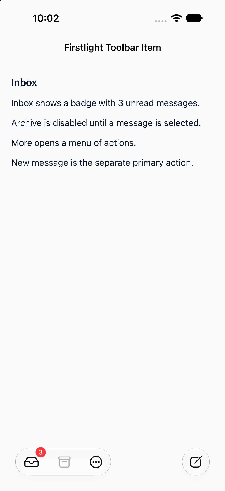
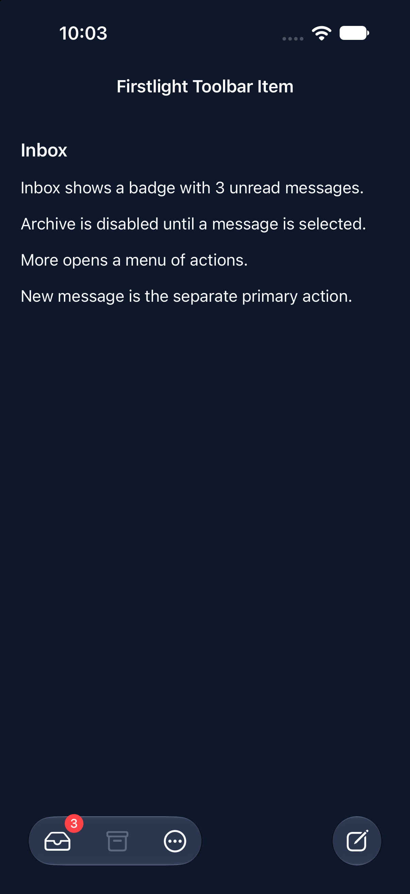
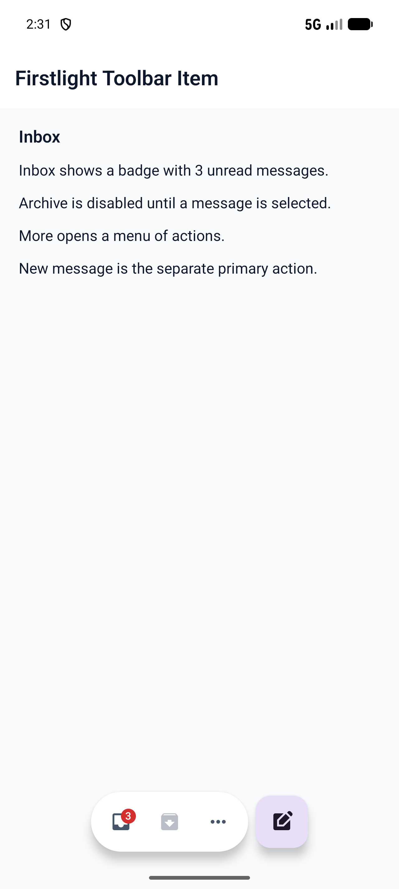
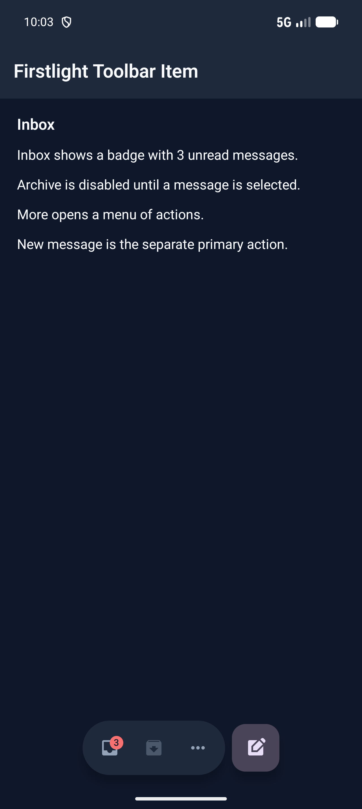

# Toolbar Item

Toolbar Item is one icon action in a [Toolbar](toolbar.md). It runs an action,
opens a menu, or, with `primary`, is the toolbar's separate primary action.

## Complete example

```blade
<firstlight:toolbar>
    <firstlight:toolbar-item
        icon="tray"
        icon-android="inbox"
        a11y-label="Inbox"
        :badge="$unread"
        haptic="keypress"
        @press="openInbox"
    />
    <firstlight:toolbar-item
        icon="ellipsis.circle"
        icon-android="more_horiz"
        a11y-label="More"
        :menu="[
            ['method' => 'duplicate', 'label' => 'Duplicate', 'icon' => 'plus.square.on.square'],
            ['method' => 'archive', 'label' => 'Archive', 'disabled' => ! $canArchive],
            ['method' => 'confirmDelete', 'label' => 'Delete', 'icon' => 'trash', 'role' => 'destructive'],
        ]"
    />
    <firstlight:toolbar-item primary icon="square.and.pencil" icon-android="edit_square" a11y-label="New message" :disabled="! $canCompose" @press="compose" />
</firstlight:toolbar>
```

Toolbar Item is self-closing and has no visible text. It renders only inside a
Toolbar.

## Props

| API | Accepted type | Purpose |
| --- | --- | --- |
| `icon` | non-empty `string` | Required shared icon name and cross-platform fallback. Accepts a [custom icon](../how-to/use-custom-icons.md) as `custom:<name>`. |
| `icon-ios` | `IosSymbol|string` | Optional iOS override. |
| `icon-android` | `AndroidSymbol|string` | Optional Android override; typed filled or outlined variants are preserved. |
| `a11y-label` | non-empty `string` | Required action name, read by VoiceOver and TalkBack and used as the item's title in an iOS overflow. |
| `primary` | `bool` | Makes this the toolbar's separate primary action. At most one per Toolbar. Defaults to `false`. |
| `disabled` | `bool` | Prevents interaction and exposes native disabled state. Defaults to `false`. |
| `badge` | `int`, `string`, or `null` | A count or short text shown on the icon. `null`, `0` and `''` show no badge; counts above 99 show `99+`; negative counts are rejected. |
| `menu` | `array` | Entries the item opens instead of running `@press`. See [Menus](#menus). |
| `haptic` | a `FirstlightUI\Haptics\Haptic` case or its name, such as `keypress` | Haptic played when the item's action runs: a tap on an `@press` item, or choosing one of its menu entries. Silent by default. See [Play haptics](../how-to/play-haptics.md). |

Blade documentation uses kebab-case names. `iconIos`, `iconAndroid` and
`a11yLabel` are accepted as aliases.

## Events

An item takes exactly one of `@press` or `menu`. `@press` runs the named PHP
method once for a native tap:

```php
public function compose(): void
{
    // Open the composer and publish the result.
}
```

Disabled items, and disabled menu entries, never call PHP. Programmatic
publications never emit a press.

## Menus

`menu` is a list of entries. Each entry takes:

| Key | Required | Purpose |
| --- | --- | --- |
| `method` | yes | PHP method run when the entry is chosen. |
| `label` | yes | Visible entry text. |
| `icon` | no | Shared icon; `ios` and `android` override it per platform and require `icon`. |
| `role` | no | `destructive` shows the entry in the platform's destructive style. PHP still owns any confirmation. |
| `disabled` | no | Shows the entry but prevents choosing it. |

Tapping the item opens the menu: a native menu from the bar button on iOS and
a Material dropdown menu on Android. An item whose entries are all disabled is
itself disabled.

## Badges

On iOS 27 and later the badge is the system badge on the bar button. iOS 26
does not draw it, whichever Xcode builds the app, and earlier iOS does not draw
it either; VoiceOver on iOS 26 still reads the count as the item's value, so
show the count elsewhere on the screen too when it matters. Android draws a Material badge on the icon, and TalkBack
reads its text after the action name. Keep badge text short, such as a count,
because it cannot be given separate spoken wording.

At the accessibility text sizes iOS draws the system badge larger with the text,
and it can cover most of its item's icon. VoiceOver still reads the count, and a
long press on the item shows its name in the large content viewer. Firstlight
keeps the system badge rather than drawing its own.

## Accessibility

Every item requires `a11y-label`; icon names are never read. On iOS the item
is a system bar button: VoiceOver reads the label as its name and a disabled
item as dimmed. On Android it is a Material icon button or floating action
button with the label as its name and native disabled state. Menus use the
platform's own menu semantics. Native touch targets are at least 44 points on
iOS and 48 dp on Android.

Toolbar Item has no `a11y-hint` or spoken badge wording: iOS bar buttons take
neither, so neither platform offers them. Put what the action does in its
label.

## Validation and excluded APIs

Firstlight rejects a missing or blank icon or `a11y-label`, an item with
neither `@press` nor `menu` or with both, non-boolean `primary` or `disabled`,
negative badges, and menu entries with unknown keys, a blank `method` or
`label`, a `role` other than `destructive`, a non-boolean `disabled`, or a
platform icon without a shared `icon`. Visible labels, `a11y-hint`,
`badge-a11y-label`, variants, sizes, `loading`, `glass`, `url`, context menus,
bindings, and gesture directives other than `@press` are not supported.

## Compatibility

Toolbar Item supports the versions listed in the current
[compatibility reference](../reference/compatibility.md) and requires both
Firstlight native renderers to be compiled into the host application.

## Screenshots

| Platform | Light | Dark |
| --- | --- | --- |
| iOS |  |  |
| Android |  |  |
