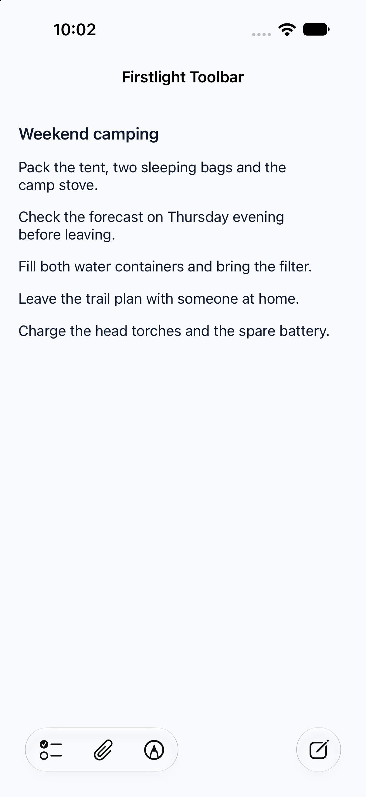
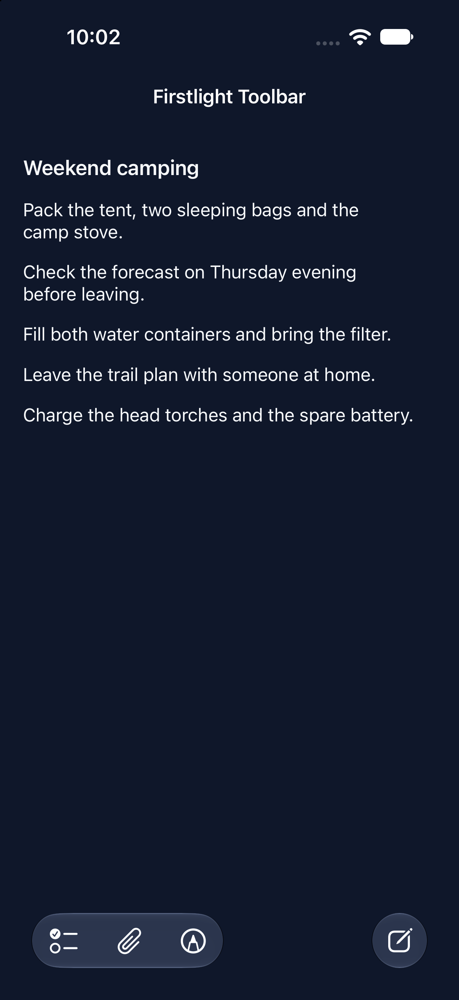
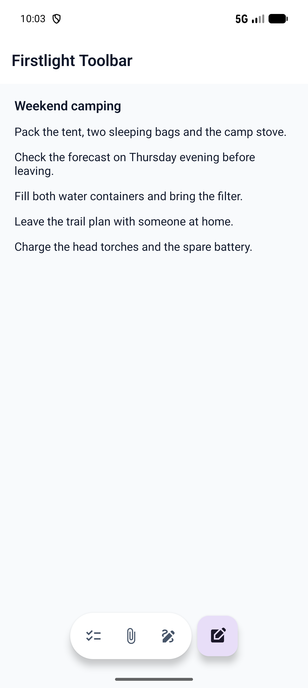
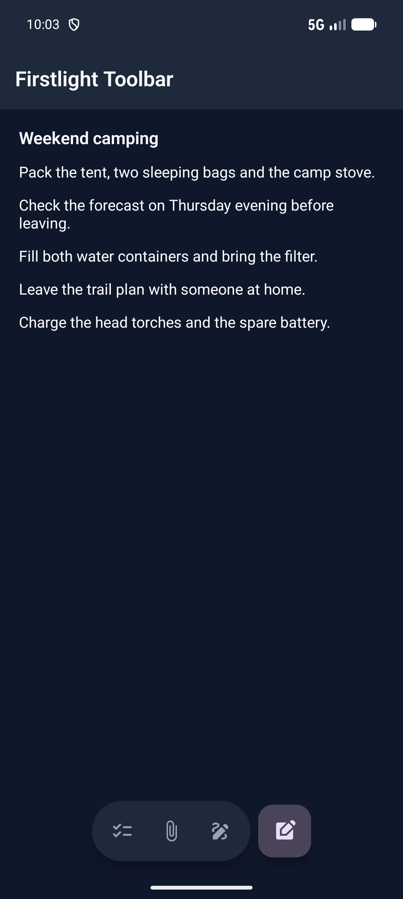

# Toolbar

Toolbar gives a screen a row of icon actions at the bottom, such as Notes'
checklist, attach and markup actions, with one separate primary action, such
as New note. iOS shows them in the system bottom toolbar and Android in a
Material 3 floating toolbar.

## Complete example

```blade
<firstlight:toolbar>
    <firstlight:toolbar-item icon="checklist" a11y-label="Checklist" @press="addChecklist" />
    <firstlight:toolbar-item
        icon="paperclip"
        icon-android="attach_file"
        a11y-label="Attach"
        :menu="[
            ['method' => 'attachPhoto', 'label' => 'Photo', 'icon' => 'photo'],
            ['method' => 'attachFile', 'label' => 'File', 'icon' => 'doc'],
        ]"
    />
    <firstlight:toolbar-item icon="pencil.tip.crop.circle" icon-android="draw" a11y-label="Markup" @press="markup" />
    <firstlight:toolbar-item primary icon="square.and.pencil" icon-android="edit_square" a11y-label="New note" @press="compose" />
</firstlight:toolbar>
```

Author one Toolbar per screen, as a direct child of the screen's root rather
than inside a list or scroll view, so it is always rendered. It takes no space
in the layout, so content does not move around it.

## Props

Toolbar takes no props. Each action is a
[Toolbar Item](toolbar-item.md) child.

## Children

| Rule | Detail |
| --- | --- |
| Child type | Only `<firstlight:toolbar-item>`. |
| Actions | One to five items without `primary`. |
| Primary action | At most one item with `primary`, shown apart from the others at the trailing end. |

A Toolbar may hold only a primary item, or only regular items.

## Layout requirement

Toolbar needs a screen shown through a native-chrome layout, which is the
default `NativeLayout` in NativePHP Mobile 4.8. On iOS the items join the
navigation stack's bottom toolbar, and a screen without a navigation stack has
no bottom toolbar to join.

## Tab bars

On a screen pushed inside a tab layout, iOS hides the tab bar and the toolbar
takes its place. On a tab's root screen iOS keeps the tab bar, which covers
the bottom toolbar, so set `$hidesTabBar` on a tab root that has a Toolbar:

```php
class NotesScreen extends NativeComponent
{
    protected bool $hidesTabBar = true;
}
```

On Android the toolbar floats above the tab bar when one is shown and above
the system navigation bar when the screen hides it.

## Platform behaviour

- **iOS:** the items join the screen's bottom toolbar. On iOS 26 and later the
  regular items share one Liquid Glass group and the primary action has its own
  glass at the trailing edge. Earlier iOS shows the classic bottom toolbar with
  the primary action at the trailing edge. iOS places the bar and sizes and
  spaces the items.
- **Android:** Firstlight floats a Material 3 floating toolbar at the bottom
  centre of the screen, above the system navigation bar, with the primary
  action as its floating action button. On a screen with a bottom tab bar it
  floats above the tabs. It slides away while content scrolls towards its end
  and returns when content scrolls back. The toolbar follows Material's
  floating toolbar measurements and colours, drawn from stable Material 3
  components.

## Events and state

Toolbar has no events. Each item's `@press`, or its menu entry's `method`,
runs once for a native tap. A republished Toolbar updates its items in place.

## Accessibility

Each item requires an `a11y-label`, which VoiceOver and TalkBack read as the
action name; items have no visible text. The Toolbar itself has no label: iOS
announces its system bar as a toolbar, and Android groups the floating
toolbar's actions so TalkBack moves through them together. Badge, disabled and
menu semantics are described on [Toolbar Item](toolbar-item.md).

## Validation and excluded APIs

Firstlight rejects a Toolbar with no items, more than five regular items, more
than one primary item, or a child other than Toolbar Item. Toolbar rejects
labels, icons, values, disabled and loading state, variants, `glass`, `haptic`,
accessibility labels, and press or other gesture directives.

## Compatibility

Toolbar supports the versions listed in the current
[compatibility reference](../reference/compatibility.md) and requires both
Firstlight native renderers to be compiled into the host application.

## Screenshots

| Platform | Light | Dark |
| --- | --- | --- |
| iOS |  |  |
| Android |  |  |
