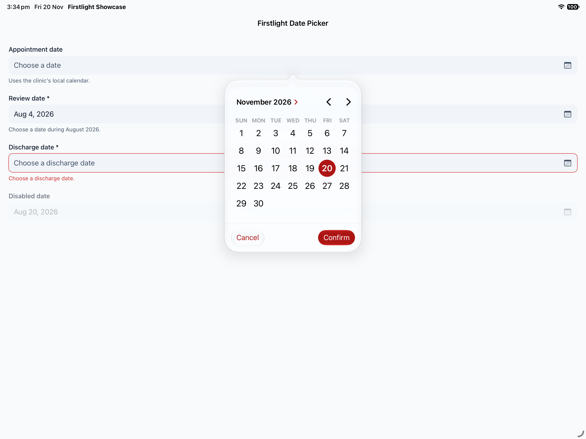
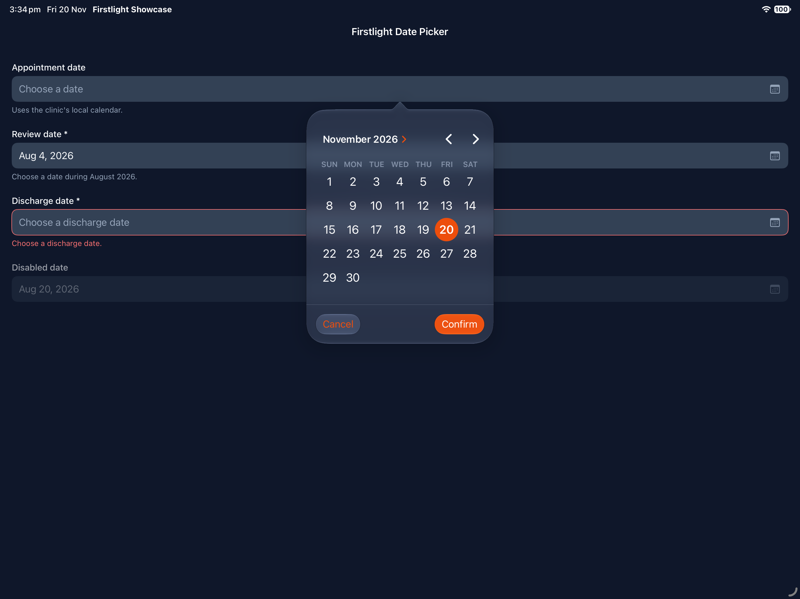
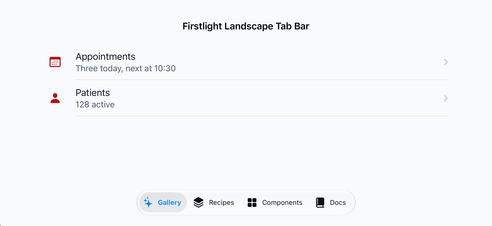
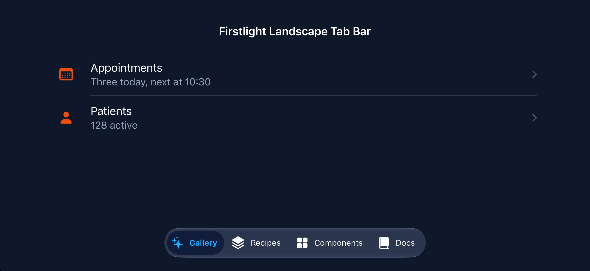
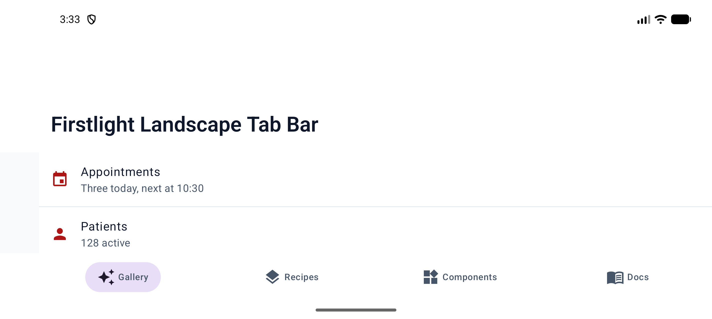
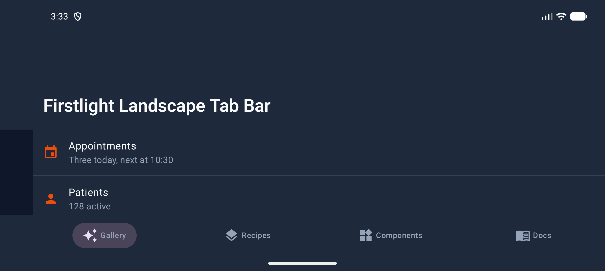
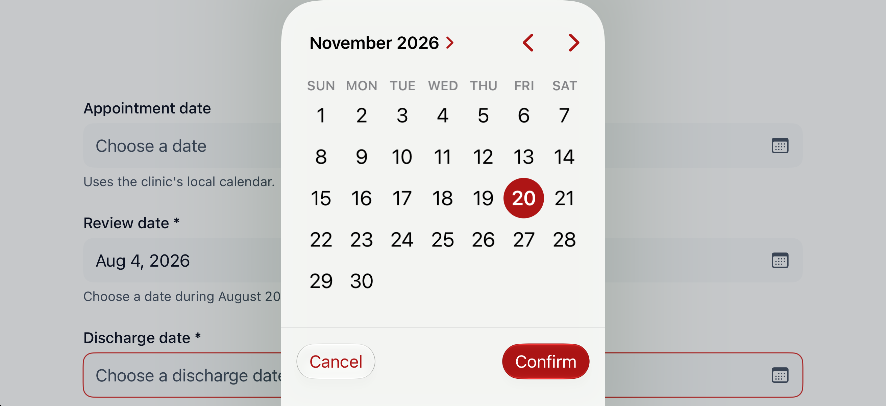
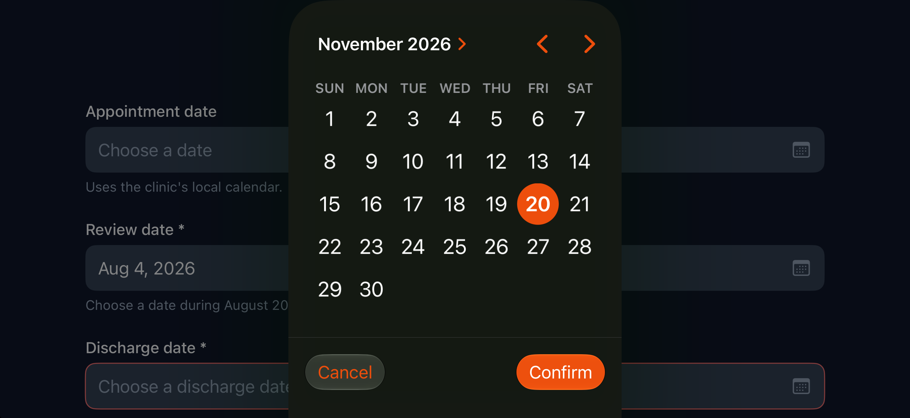
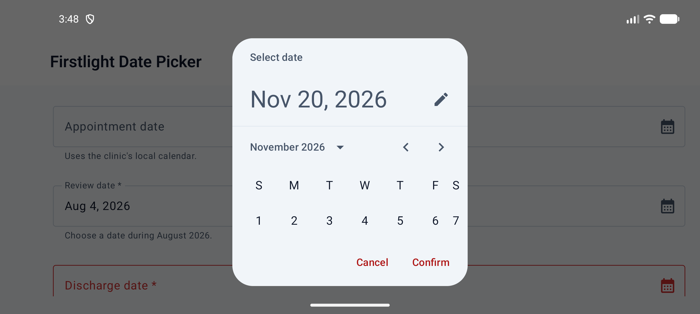
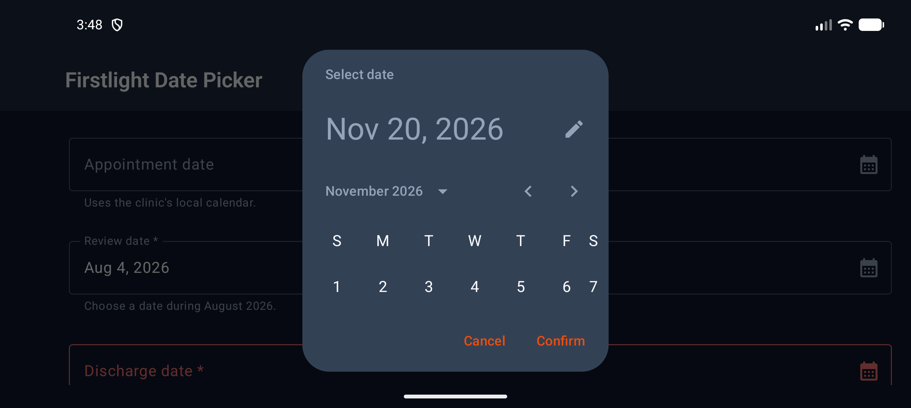

# Support Landscape and iPad

NativePHP apps are portrait-only on phones until you say otherwise. Firstlight
controls lay out in every orientation and on iPad, so turning these on is a
config change plus one line for the Android tab bar.

## Turn on landscape

Orientation comes from `config/nativephp.php`, which every build applies to
`Info.plist` on iOS and `AndroidManifest.xml` on Android. NativePHP's default
allows portrait only:

```php
'orientation' => [
    'iphone' => [
        'portrait' => true,
        'upside_down' => false,
        'landscape_left' => true,
        'landscape_right' => true,
    ],
    'android' => [
        'portrait' => true,
        'upside_down' => true,
        'landscape_left' => true,
        'landscape_right' => true,
    ],
],
```

The change takes effect in the next build.

On Android, turn on all four. Any other mix that includes landscape becomes
`fullSensor`, which follows the sensor and ignores the user's rotation lock.

## Turn on iPad

Set `'ipad' => true` in the same file. iPad apps support all four
orientations, as Apple requires, whatever the `iphone` settings say.

Once an App Store version supports iPad, later versions can't drop it, and App
Review needs iPad screenshots. Decide before you upload.

On iPad, Firstlight uses the regular-width presentations: Date Picker, Time
Picker and Select open as popovers next to their field, and Confirmation
Dialog is a centred alert with both actions.

| Platform | Light | Dark |
| --- | --- | --- |
| iOS |  |  |

## Use Firstlight's tab bar on Android

On Android, NativePHP draws a layout's tabs as Material's 80 dp navigation bar.
It stays above the keyboard, so it can cover the field being edited, and in
landscape it and the app bar leave little room for content. Select
Firstlight's tab bar in your layout instead:

```php
use Native\Mobile\Edge\Layouts\Builders\Tab;
use Native\Mobile\Edge\Layouts\Builders\TabBar;
use Native\Mobile\Edge\NativeComponent;

public function tabBar(NativeComponent $screen): ?TabBar
{
    return TabBar::make()
        ->presentation('firstlight:tabs')
        ->add(Tab::link('Home', '/', icon: 'home'))
        ->add(Tab::link('Settings', '/settings', icon: 'settings'));
}
```

NativePHP still owns the tabs, selection, badges and navigation. Firstlight
draws the bar the way Material recommends:

| When | Bar |
| --- | --- |
| Keyboard up | Hidden, so the field stays visible |
| Window shorter than 480 dp, such as a phone in landscape | Short bar, 64 dp, label beside the icon |
| Otherwise | Standard navigation bar, 80 dp |

Transient Feedback snackbars sit above whichever bar is showing.

| Platform | Light | Dark |
| --- | --- | --- |
| iOS |  |  |
| Android |  |  |

iOS keeps the system tab bar, which already behaves this way. In debug builds
NativePHP logs one line saying no iOS presenter is registered for
`firstlight:tabs`; that is expected.

## What changes in landscape

- Date Picker and Time Picker on a short Android screen put the header beside
  the calendar and the time beside the clock dial, in a dialog that fits the
  screen and scrolls, with Cancel and Confirm always visible. iPhone keeps a
  sheet sized to the picker.
- The Media crop sheet puts its controls beside the image.
- Bottom Sheet detents don't apply on a phone in landscape: iOS shows the
  sheet at full height.

| Platform | Light | Dark |
| --- | --- | --- |
| iOS |  |  |
| Android |  |  |
