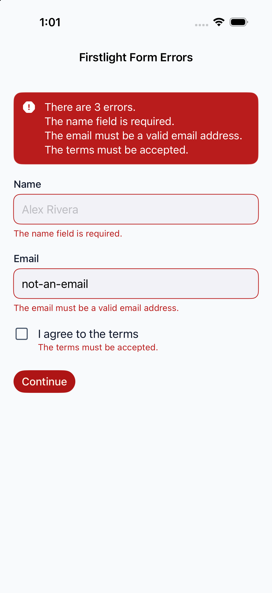
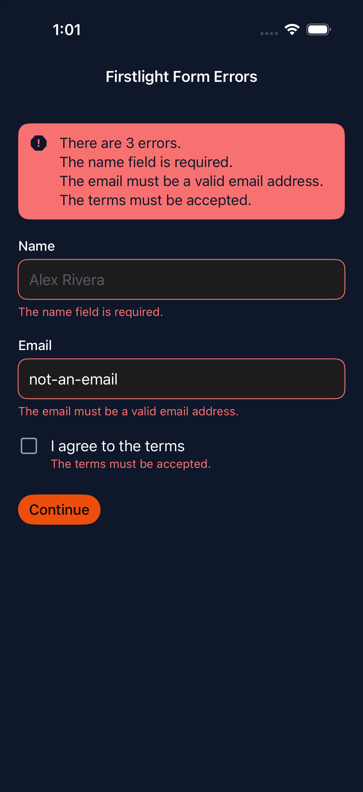
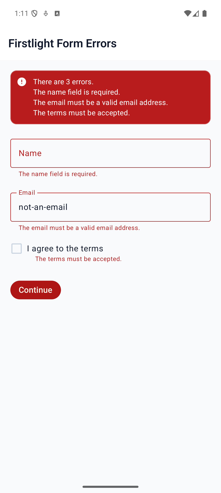
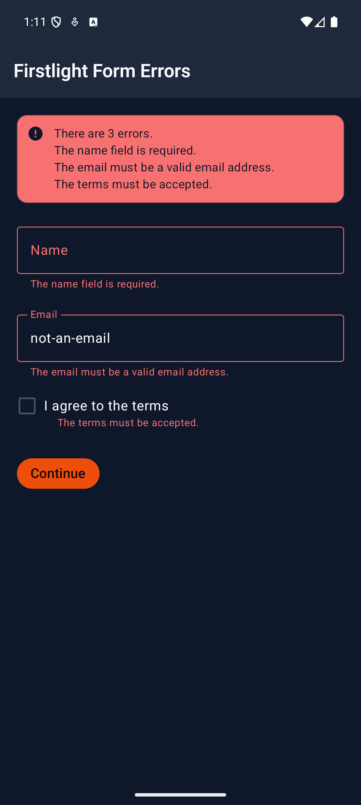
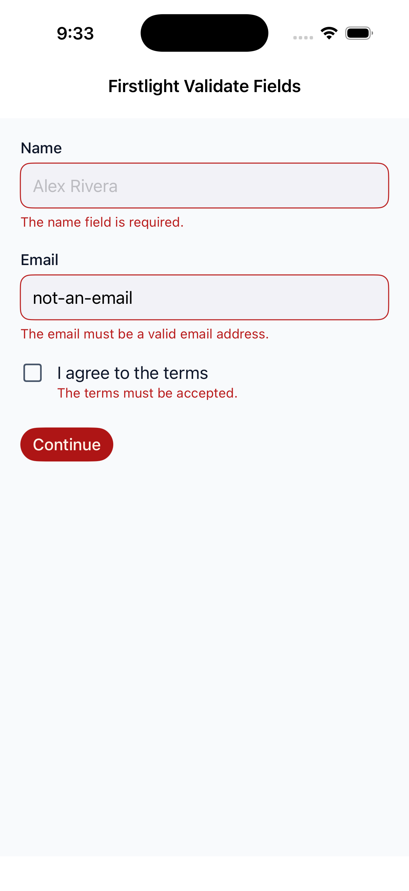
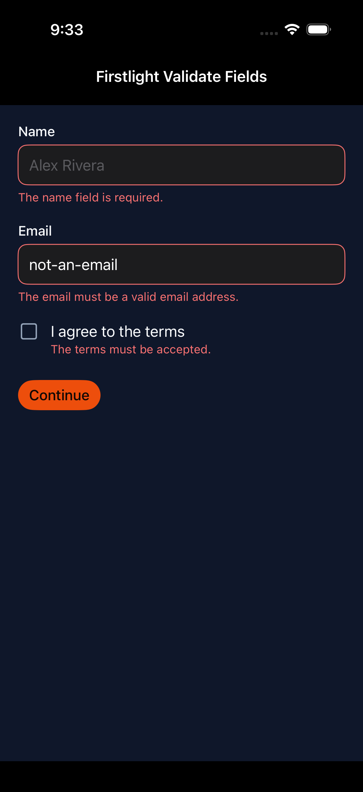
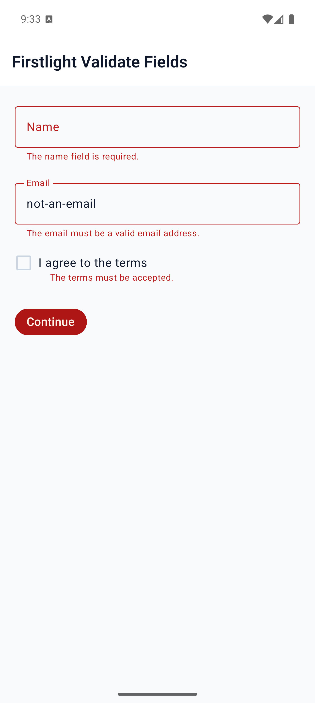
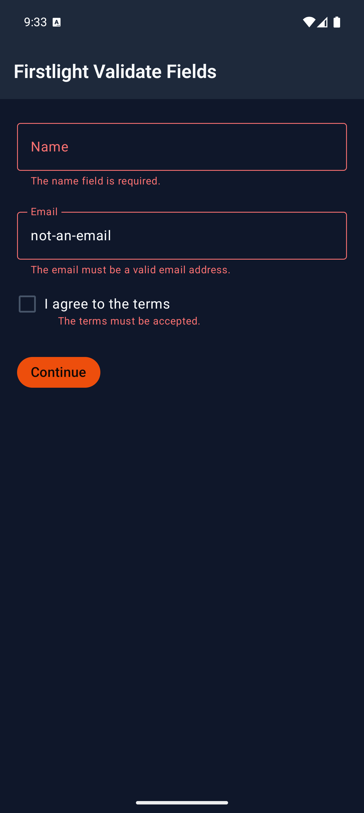

# Validate Firstlight Fields

Firstlight extends NativePHP Mobile's `ValidatesInput` with Form Request
sources, Media conversion, error summaries, and accessibility announcements.
Call `$this->validate()` or `$this->validateOnly()`; participating fields show
the first `MessageBag` message in the native `error` slot. Firstlight and
Mobile UI controls share the upstream `FieldErrors` bag on the same screen.

Do not place `@nativeError` next to Firstlight fields. That directive emits a
sibling text node and skips native field error colour, helper replacement, and
accessibility. Use `ValidatesFields`, `error-for`, or an authored `error`
instead.

The method contract, participating fields, and current limitations are listed
in the [ValidatesFields reference](../reference/validates-fields.md).

## Opt in

Extend `FirstlightUI\NativeComponent`, which includes `ValidatesFields` and
the full nonstreaming response-revision contract:

```php
use FirstlightUI\NativeComponent;

class SignupScreen extends NativeComponent
{
}
```

The trait remains usable separately, but adding it to the upstream EDGE base
does not provide the publication contract. Blade render paths are automatic;
programmatic Element roots must return `$this->response($element)` to add normal
chrome and the revision. Nested children are untouched, partials are unstamped,
and streaming cannot be opted into. Repeated validation responses use this
same contract, not a per-event acknowledgement. See
[Compatibility](../reference/compatibility.md#runtime-response-contract).

## Declare rules and bind fields

Rule keys must match public property names (`email` ↔ `native:model="email"`).
Nested and wildcard keys are not supported.

```php
public string $name = '';

public string $email = '';

public bool $accepted = false;

/** @var array<string, string> */
protected array $rules = [
    'name' => 'required|min:2',
    'email' => 'required|email',
    'accepted' => 'accepted',
];

/** @var array<string, string> */
protected array $validationAttributes = [
    'accepted' => 'terms',
];

public function updatedEmail(): void
{
    $this->validateOnly('email');
}

public function save(): void
{
    $this->validate();
}
```

```blade
<firstlight:text-field label="Name" native:model.blur="name" />
<firstlight:text-field
    label="Email"
    keyboard="email"
    content-type="email"
    autocapitalize="none"
    :autocorrect="false"
    native:model.blur="email"
/>
<firstlight:checkbox label="I agree to the terms" native:model="accepted" />
<firstlight:button label="Continue" @press="save" />
```

No `:error` wiring is required. After a failed `validate()` or
`validateOnly()`, the next published frame fills each field's `error` from
`MessageBag::first($field)`. `required` on a field is display metadata only;
Laravel `required`, `accepted`, and other rules remain the enforcement.

You do not wrap `@press` handlers in `try`/`catch`. Firstlight stores the
exception's bag and republishes the screen with field messages.

## Validate one field on blur or live

`updated{Property}` runs when PHP accepts that property. Pair it with the sync
mode that should trigger the check.

Blur publishes on focus loss, then validates only that key:

```blade
<firstlight:text-field label="Email" native:model.blur="email" />
```

```php
public function updatedEmail(): void
{
    $this->validateOnly('email');
}
```

Live publishes while editing:

```blade
<firstlight:text-field label="Email" native:model.live="email" />
```

`validateOnly('email')` replaces only the `email` messages. Other keys already
in the bag stay put. A passing `validateOnly()` clears that key.

You can call `validateOnly()` from `@change` or `@submit` instead of
`updated{Property}` when the field should invoke a named method.

## Use a Form Request

Pass a class name to `validate()` or `validateOnly()`. Firstlight reads that
object's `rules()`, `messages()`, and `attributes()` and runs them against the
screen's public properties. It does not perform an HTTP redirect.

```php
use Illuminate\Foundation\Http\FormRequest;

class StoreSignupRequest extends FormRequest
{
    public function rules(): array
    {
        return [
            'name' => 'required|min:2',
            'email' => 'required|email',
            'accepted' => 'accepted',
        ];
    }

    public function messages(): array
    {
        return [
            'email.required' => 'Need an email address.',
        ];
    }

    public function attributes(): array
    {
        return [
            'accepted' => 'terms',
        ];
    }
}
```

```php
public function save(): void
{
    $this->validate(StoreSignupRequest::class);
}
```

`authorize()` and other Form Request HTTP behaviour are unused. You can also
pass a plain class that implements those three methods.

## Bind a different MessageBag key

When the rule key differs from the model name, set `error-for`:

```blade
<firstlight:text-field
    label="Work email"
    native:model="email"
    error-for="contact_email"
/>
```

```php
protected array $rules = [
    'contact_email' => 'required|email',
];
```

`error-for` wins over `native:model` when both are present.

## Let an authored error win

A non-empty authored `error` attribute wins over the MessageBag. Use it for
application-specific copy that should not come from Laravel rules:

```blade
<firstlight:text-field
    label="Email"
    native:model="email"
    error="This account is already registered."
/>
```

An empty authored `error` is treated as unset, so the bag can still fill the
slot. You can also bind explicitly from the `$errorBag` the trait shares with
the view:

```blade
<firstlight:text-field
    label="Email"
    native:model.blur="email"
    :error="$errorBag->first('email')"
/>
```

## Add and clear messages

Use the same bag for server-side checks that are not Laravel rules:

```php
public function save(): void
{
    $this->validate();

    if ($this->emailIsTaken()) {
        $this->addError('email', 'This account is already registered.');

        return;
    }

    $this->resetValidation();
}
```

`resetValidation('email')` forgets one key. `resetValidation()` clears the
bag. `hasError('email')` and `getErrorBag()` inspect the current messages.

## Show form-level errors

Some failures belong to the form, not one field: wrong credentials, a declined
card, a server conflict. Add them under a key no field uses and show that key
with a Callout:

```php
public function signIn(): void
{
    $this->validate();

    if (! Auth::attempt(['email' => $this->email, 'password' => $this->password])) {
        $this->addError('form', 'These credentials do not match our records.');
    }
}
```

```blade
<firstlight:callout error-for="form" />
<firstlight:text-field label="Email" native:model.blur="email" />
<firstlight:text-field label="Password" secure native:model.blur="password" />
<firstlight:button label="Sign in" @press="signIn" />
```

To summarise every message above a long form, use `error-summary`:

```blade
<firstlight:callout error-summary />
```

The summary lists each key's first message in bag order, which follows your
rules, so declare rules in the order the fields appear. One message is shown
alone; two or more get a heading such as `There are 3 errors.` and one message
per line.

Both Callouts default to the `danger` tone, take their text from the bag (so
`message` is rejected), and render nothing while there is nothing to show. You
can still set `tone` or add an `action-label` with `@press`. `error-for` and
`error-summary` cannot be combined.

## Screen-reader announcements

After a failed interaction, Firstlight announces the errors once:

- **A press or keyboard submit** (Button `@press`, field `@submit`) speaks the
  whole summary, for example `There are 2 errors. The name field is required.
  The email field is required.`, and moves screen-reader focus to the first
  invalid field on the screen.
- **A field update** (`native:model.blur`, `.live`, `@change`, and
  `updated{Property}` hooks) speaks only the message that update just added
  and leaves focus where it is.

On iOS, VoiceOver focus moves to the first invalid field and the announcement
follows it; the keyboard does not open. On Android, while TalkBack is on, Text
Field, Text Area, and Code Editor take input focus, which TalkBack follows and
reads with the error, and the keyboard opens; other fields only announce,
because Android moves focus only to editable text. Nothing is spoken when no message was added, and republishing
the same screen does not repeat the announcement.

The summary heading is package chrome. Translate it by publishing the language
files (see [Localize chrome](localize.md)) and editing
`lang/vendor/firstlight/{locale}/validation.php`.

The `/captures/form-errors` showcase route shows a summary above failed
fields:

| Platform | Light | Dark |
| --- | --- | --- |
| iOS |  |  |
| Android |  |  |

## Do not validate during mount or render

`mount()` and `render()` still sit on NativePHP's generic `Throwable` overlay
path. Throwing `ValidationException` there paints the red error overlay instead
of field messages. Call `validate()` and `validateOnly()` from actions,
`@submit` / `@change` handlers, and `updated{Property}` hooks.

`addError()` does not throw and is safe from `render()` when a fixture needs a
stable failed frame.

## Screenshots

These development screenshots were captured from the dedicated
`/captures/validate-fields` showcase route. The interactive dogfood screen is
`/validation`.

| Platform | Light | Dark |
| --- | --- | --- |
| iOS |  |  |
| Android |  |  |
